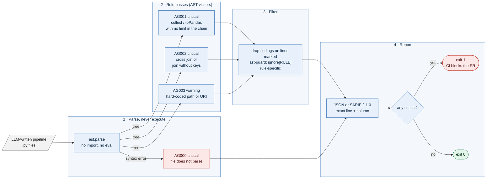

# datapipeline-ast-guard — a pre-merge safety check for AI-written data pipeline code


**Status: v0.1, portfolio project.** Three rules, JSON and SARIF output, CLI and tests are complete. **Detection quality on real agent-written pipelines has not been measured yet**; that is the main open item ([Limitations](#limitations), [docs/RESULTS.md](docs/RESULTS.md)).

```text
$ agent-lint examples/agent_written_pipeline.py          # exit code 1
AG003 warning   line 7   Hard-coded file-system path           spark.read.parquet("s3://prod-data/orders/2026/")
AG003 warning   line 8   Hard-coded file-system path           spark.read.csv("/data/customers.csv", ...)
AG002 critical  line 10  Cross join, or join without keys     orders.join(customers)
AG002 critical  line 11  Cross join, or join without keys     customers.crossJoin(orders.select("region"))
AG001 critical  line 13  Unbounded collect()/toPandas()       enriched.collect()
```

*Real findings from [examples/agent_written_pipeline.py](examples/agent_written_pipeline.py). The tool itself prints JSON or SARIF (rule, severity, line, column, message); I have reformatted the lines and added the offending source text on the right for readability. Line 14, `enriched.limit(100).toPandas()`, is correctly not flagged.*

## What is this? (plain-language overview)

AI coding assistants now write a lot of data-engineering code: Spark jobs, Polars scripts, SQL glue. That code often looks right and passes a unit test on ten rows, then fails or becomes very expensive on a real cluster. The same few mistakes keep appearing:

- a **join with no keys** (or an explicit cross join) that turns two million rows into four trillion;
- **`.collect()` or `.toPandas()`** on a whole distributed table, which pulls everything into one machine's memory;
- **hard-coded paths** (`s3://prod-data/...`, `/data/customers.csv`) that tie the code to one environment.

datapipeline-ast-guard is a small command-line tool that reads Python files and flags those patterns **without running them**. It parses each file into an abstract syntax tree (the structure Python itself builds), walks the tree looking for the patterns, and reports each finding with an exact line and column. If any finding is *critical*, the command exits with a non-zero status, which is what makes a CI job fail and a pull request block.

**What it is not.** It is not a type checker, a style linter, or a general code-quality tool, and it does not understand your data. It is a handful of narrow, explainable rules aimed at one failure family.

### Who it is for, and when it earns its place

| If you are... | the tool gives you... |
| --- | --- |
| a team that lets AI assistants open PRs against data pipelines | an automatic gate that stops the classic cluster-killers before review |
| a data engineer reviewing AI-generated code | a short list of lines to look at first |
| building an agent that writes data code | a deterministic check to run on its output **before** anything executes, so a bad generation never has side effects |
| in a regulated or air-gapped environment | a checker with no network access and no model, so results are reproducible and explainable |

It is a poor fit if you need semantic checks (does this join logic match the business rule?), type or schema checking, or coverage of rules beyond the three listed below.

### Why static analysis instead of running the code, or asking an LLM?

Running generated code to see if it is safe is the thing you are trying to avoid. Asking another LLM adds cost, variability and its own blind spots. A syntax-tree rule gives the same answer every time, takes milliseconds, can be unit-tested, and can say exactly which line it objects to and why.

**What's real and what's not.** Everything described here runs today. What is **not** established is how often these rules are right on real agent-written code: the benchmark corpus is not built yet, so there are no precision or recall numbers, and the rules are heuristics with known blind spots (see [Limitations](#limitations)).

## At a glance

| | |
| --- | --- |
| Input | Python files or directories |
| Output | JSON list, or SARIF 2.1.0 (for GitHub code scanning), with rule id, severity, file, line, column |
| Exit code | 1 if any critical finding, otherwise 0 (warnings do not fail) |
| Rules | AG000 unparseable file, AG001 unbounded collect, AG002 cross join or keyless join, AG003 hard-coded path |
| Suppression | `# ast-guard: ignore[AG001]` on the line, rule-specific |
| Dependencies | Python 3.11+, `click`; no network, no model |
| Tests | 10, including a property-based test that arbitrary text never crashes the analyser; `mypy --strict`; ruff |

## Architecture at a glance



*Everything here is deterministic: there is no model anywhere in the tool. That is the point: it is the check you put in front of the probabilistic code-writer.*

## Quickstart

```bash
git clone https://github.com/PCSchmidt/datapipeline-ast-guard && cd datapipeline-ast-guard
uv venv && uv pip install -e ".[dev]"

agent-lint examples/agent_written_pipeline.py                 # JSON, exit 1
agent-lint src/pipelines --format sarif > guard.sarif         # SARIF for code scanning
pytest -q                                                     # 10 passed
```

As a CI step (GitHub Actions):

```yaml
- run: pip install datapipeline-ast-guard      # not on PyPI yet: use `pip install git+https://github.com/PCSchmidt/datapipeline-ast-guard`
- run: agent-lint pipelines/ --format sarif > guard.sarif
- uses: github/codeql-action/upload-sarif@v3
  if: always()
  with: { sarif_file: guard.sarif }
```

Suppress a reviewed line: `rows = small_df.collect()  # ast-guard: ignore[AG001]`. Suppression is per rule, so it can never hide a different problem on the same line.

## Approach: why it is built this way

- **Parse, don't run.** The tool never imports or executes the code it checks, so an unsafe generation cannot do harm while being checked.
- **Narrow rules, each explainable in one sentence.** A finding you cannot explain is a finding people learn to ignore.
- **Fail closed on broken input.** A file that does not parse is a *critical* finding (AG000), not a skipped file.
- **Severity means something.** Critical blocks the merge; a warning (hard-coded path) informs and does not.
- **Standard output formats.** JSON for scripts, SARIF 2.1.0 so GitHub code scanning can show findings inline on the PR.

## Motivation

This is the "deterministic gate in front of a probabilistic generator" idea applied to data-engineering code. My background includes enterprise PySpark and Pandas pipeline delivery, and the failure modes above are the ones that matter most there. The tool is deliberately small: the aim was a trustworthy first gate, not a complete linter.

## Method (what the tool actually does)

1. **Parse** each file with `ast.parse`. A syntax error becomes one AG000 finding for that file and the run continues.
2. **Walk the tree** with a single visitor:
   - *AG001*: for every call named `collect`, `toPandas` or `to_pandas`, look at the method names earlier in the same call chain; flag it unless one of `limit`, `head`, `take`, `first`, `sample`, `fetch` is present.
   - *AG002*: flag `crossJoin`, `how="cross"`, and `.join(other)` with no `on`/`left_on`/`using` keyword and no second positional argument.
   - *AG003*: flag string literals that look like an absolute path (`/dir/file`, `C:\...`) or a URI with scheme `s3`, `s3a`, `gs`, `abfs`, `abfss`, `hdfs`, `dbfs` or `file`.
3. **Apply suppressions**: drop a finding if its own line carries `# ast-guard: ignore[...]` naming that rule.
4. **Report** sorted by line, as JSON or SARIF, and exit 1 if any finding is critical.

## Results

There are **no detection-quality results yet**. What is verified today:

- 10 unit and property-based tests pass: each rule's positive and negative cases, suppression, a syntax error producing AG000 instead of a crash, ordinary string and path joins not being mistaken for DataFrame joins (a bug found while writing this README), SARIF structure and 1-based positions, CLI exit codes, and a hypothesis test that arbitrary text never raises.
- The worked example above is real output.
- `mypy --strict` and ruff are clean; the Docker image builds and passes its tests offline.

What is planned and not done: a corpus of 200+ LLM-generated PySpark and Polars scripts, hand-labelled for these rules and split into development and test sets before any rule is tuned, with per-rule precision, recall and false-positive rate. See [docs/RESULTS.md](docs/RESULTS.md).

## Limitations

- **Heuristics, no types.** Receiver types are unknown, so a non-DataFrame object with a `.collect()` method is flagged. AG002 skips string-literal receivers, `os.path.join` and list/generator arguments, but `sep.join(parts)` (a variable receiver with a variable argument) looks exactly like a DataFrame join and **is flagged**; suppress it with the comment.
- **Chain-local bounds only.** A limit applied on an earlier statement (`small = df.limit(5)` then `small.collect()`) is not tracked, so AG001 fires. Use the suppression comment where the bound is real.
- **Only three rules.** Not covered: unpartitioned shuffles, null-unsafe join keys, missing schema assertions after JSON ingestion, SQL (`sqlglot`) rules, and property-based schema-invariance checks.
- **Join keys are not validated.** AG002 checks that keys are given, not that they are the right ones.
- **Paths in comments and docstrings** that look like paths can raise a warning.
- **Not on PyPI yet**, and no measured false-positive rate on real code.

## Operational notes

### What runs where

A local command-line tool or a CI step. No server, no network access, no model, no credentials.

### Data and keys

No keys. The analysed source is read from disk and never leaves the machine. Nothing is stored.

### Verify the claims (a reviewer's path)

```bash
pytest -q                                              # 10 passed
mypy src tests                                         # strict, clean
agent-lint examples/agent_written_pipeline.py; echo $? # the findings above, then 1
docker build -t ast-guard . && docker run --rm --network none ast-guard   # tests offline
```

### Documentation map

| Doc | What it covers |
| --- | --- |
| [docs/RESULTS.md](docs/RESULTS.md) | what is verified, and the planned (not run) benchmark protocol |
| [examples/agent_written_pipeline.py](examples/agent_written_pipeline.py) | the sample used in the output above |
| [src/datapipeline_ast_guard/rules.py](src/datapipeline_ast_guard/rules.py) | every rule, in about 120 lines |

## License

MIT. See [LICENSE](LICENSE).

## Author

Chris Schmidt ([PCSchmidt](https://github.com/PCSchmidt)). Part of a portfolio on evaluator-gated AI systems: probabilistic components propose, deterministic gates decide.
