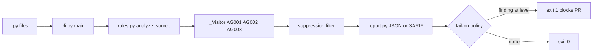
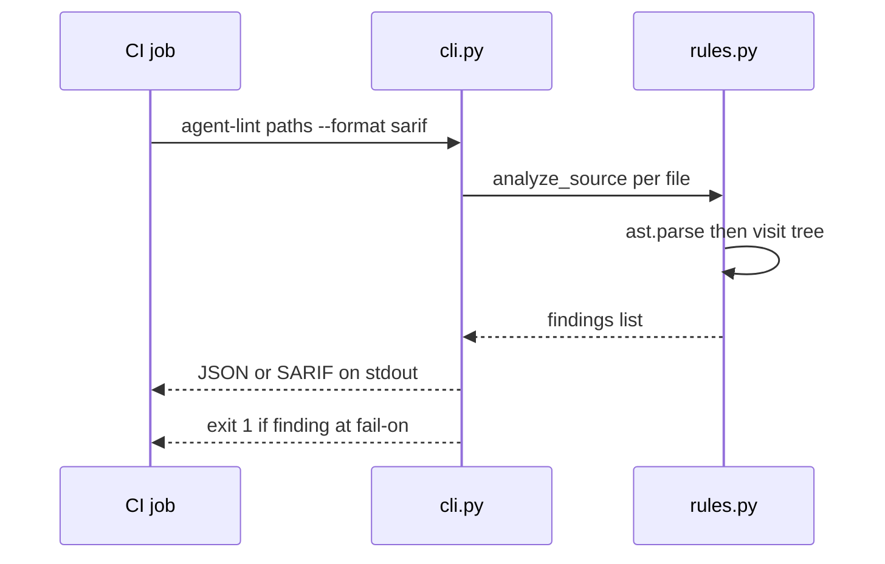

# datapipeline-ast-guard — Master Explainer

Repo: <https://github.com/PCSchmidt/datapipeline-ast-guard> · License: MIT · Version 0.5.0 (`pyproject.toml`) · Last commit: 2026-10-14 (`cb6bd1b`)
Status: portfolio measured study + small CLI tool ("portfolio project", README) · active burst 2026-10-09 → 2026-10-14 (34 commits, 7 tags) · "finished or paused" [Unknown]
Explainer generated: 2026-10-18 by an AI agent under Chris Schmidt's direction · Questionnaire v1.2 · Depth: LITE (LITE run)

> Tags: **[Verified]** seen in code/config/tests/commits (cited `path:line`, function, SHA); **[Documented]** stated in a committed doc (cited); **[Author]** confirmed `AUTHOR_CONTEXT.md` answer line (2026-10-18; ⚠ lines = [Inferred]); **[Inferred]** reasoned from stated evidence; **[Proposed]** not in the repo; **[Unknown]** → §26. **This run performs no execution** (run brief): nothing is [Measured]; the repository was inspected read-only (reads, listing, `git log`/`git show` only). `corpus/` content is untrusted third-party and model-written test material, treated as data, never as the project's own code. One fact, one home; cross-referenced by ID (CL-…, W-…, D-…, §n). Section 9 is carried over from this run's section draft (`datapipeline-ast-guard.math.md`), citations preserved.

## TL;DR

**V.1** datapipeline-ast-guard reads AI-written data-pipeline Python and flags three families of cluster-killing mistakes — unbounded `collect()`/`toPandas()`, keyless or cross joins, hard-coded paths — by parsing the syntax tree and never running the code, so a deterministic gate can block a bad generation before anything executes. [Verified] `src/datapipeline_ast_guard/rules.py:1,26-31`

**V.2** It is built for teams whose AI assistants open PRs against Spark/Polars/pandas pipelines, and its real contribution is measurement discipline rather than rule novelty: pre-registered protocols committed before each study, held-out halves scored once, four unseen corpora, Wilson intervals, repository-level bootstrap, mutation and metamorphic checks — and negative results published as such (`AG002` has never found a real defect; `AG001` is precise but actionable only about 1 time in 15). [Documented] `docs/PROTOCOL*.md`, `docs/RESULTS*.md` The interesting caveats this review adds: a stale README paragraph still says the benchmark corpus "is not built yet" although four studies are committed (D-1), the mutation runs are described as side-effect-free although their result JSONs record lost findings (D-3), every precision figure rests on single-rater author labels (W-EVAL-1), and all 34 commits carry `Co-Authored-By: Claude Sonnet 5.5` trailers while the author names several different tools (§17, §24 D-5).

## Repository fact sheet

| Field | Value | Tag / source |
| --- | --- | --- |
| Name · URL · license | datapipeline-ast-guard · github.com/PCSchmidt/datapipeline-ast-guard · MIT (`LICENSE`) | [Verified] tree, `pyproject.toml` |
| One-line description (from code) | parse Python → walk AST → AG000–AG003 findings → JSON/SARIF → exit 1 at `--fail-on` | [Verified] `cli.py:27-35`, `rules.py:26-31` |
| Category / flags | research study + CLI tool · `[MATH]` `[RESEARCH]` `[DATA]` (corpus); no `[AI]`/`[AGENT]` at runtime, no `[UI]`/`[API]`/`[DEPLOY]` | [Inferred] |
| Size | 300 tracked files: corpus 219 · results 43 · scripts 17 · docs 8 · src 4 (~467 lines: `rules.py` 368, `report.py` 58, `cli.py` 35) · tests 1 file (249 lines, 28 test functions) · root 5 · `.github` 2 | [Verified] `git ls-files`, static counts |
| History | 34 commits on `main`, 2026-10-09 16:53 −0400 (`86dba32`) → 2026-10-14 12:55 −0400 (`cb6bd1b`); tags `v0-as-shipped`, `v1-after-dev`, `v2-frozen`, `v3-frozen`, `v4-frozen`, `v0.4.0`, `v0.5.0` | [Verified] `git log`, `git show-ref` |
| Entry points | console scripts `agent-lint` / `datapipeline-ast-guard` → `cli.py:main`; evaluation harness `scripts/evaluate.py` (+ `evaluate_extra.py`, `mutate.py`, `summarise_human.py`, `pool_results.py`, `collect_*`, `generate_corpus.py`, `audit_*`, `score_*`) | [Verified] `pyproject.toml`, `scripts/` |
| Clean clone / tests | Not executed (run brief). Static: 28 `def test_` functions in `tests/test_rules.py`, incl. one Hypothesis property test. README quickstart claims "28 passed"; the at-a-glance table says "10" (D-2) | [Verified] static; [Documented] "28" |
| Lint / types / CI | `mypy` strict configured (`pyproject.toml`); CI (`ci.yml`) runs `mypy src tests` and `pytest -q` on Python 3.12; **ruff configured but not run in CI** | [Verified] `pyproject.toml`, `.github/workflows/ci.yml` |
| Dependencies | runtime: `click>=8.1` only; dev: `pytest>=8`, `hypothesis>=6.100`, `mypy>=1.10`, `ruff>=0.5`; no lockfile, no upper pins | [Verified] `pyproject.toml` |
| External services / paid APIs | none at runtime (no network, no model, no keys); corpus collection clones public GitHub repos and generation used local Ollama models (evaluation only) | [Verified] imports; [Documented] README "Reproduce" |
| AI coding tools evidenced | 34/34 commits carry `Co-Authored-By: Claude Sonnet 5.5 <noreply@anthropic.com>`; author answer names Claude Code, GitHub Copilot, Codex, Prime-Agent [Author]; no instruction files in repo | [Verified] `git log`; [Author] `AUTHOR_CONTEXT.md` Q3–Q4 |
| Related repos | evaluator-gated roadmap study family (⚠ grouping → [Inferred]); no shared code imported | [Inferred] `AUTHOR_CONTEXT.md` |
| Headline claims | 15, audited §11 (CL-01…CL-15) | [Verified] README, `docs/RESULTS*.md` |
| Scripts that write tracked files (not run) | `evaluate.py` writes `results/*.json` + temp `results/_rules_*.py` (gitignored); `summarise_human.py`, `pool_results.py`, `mutate.py` write `results/*.json`; `collect_*` clone into untracked `corpus/{human,fresh*}/`; `generate_corpus.py` needs Ollama | [Verified] script bodies, `.gitignore` |
| Secrets | no key-like filenames in tracked history (`git log --all --name-only` scan); no `.env` tracked; commit subjects/bodies read this run contain no secrets | [Verified] |

## 1. For everyone (A)

**A.1 ★** In one sentence: it is a spell-checker for one failure family in AI-written data-pipeline code — it reads a Python file as text and says "this line will pull a whole table onto one machine / multiply two tables / break in another environment", without ever running the file. [Verified] `rules.py:1`.

**A.2 ★** The everyday problem: AI coding assistants now write Spark, Polars and pandas jobs that pass a ten-row unit test and then fail expensively on a real cluster (a cross join turns two million rows into four trillion; `collect()` exhausts a driver) (README "What is this?" [Documented]). Before it existed, teams either reviewed every generated line by hand or ran the code and found out at cluster scale [Inferred] from README motivation.

**A.5 ★** The analogy under the hood: airport security X-ray. The bag (the generated code) is never opened (never executed); an officer judges from the shape of what is inside and flags only the shapes on a short, explainable list. [Verified] "Parse, don't run", README "Approach".

**A.10 ★** What it can't do: it has no types, so it cannot tell a DataFrame from a thread or a string builder; it does not validate that join keys are *right*; it covers only three rules; it does not understand SQL, notebooks or semantics; and its measured actionable yield on real code is low (about one `AG001` finding in fifteen is worth a reviewer's time) (README Limitations [Documented]; §11).

## 2. Purpose, problem, users, scope (B)

**B.1 ★** The problem as a problem: teams that let AI assistants open PRs against data pipelines keep meeting the same few mistakes — keyless/cross joins, unbounded materialisation, hard-coded environment paths — and they surface late, at cluster scale, in code that looked fine (README "What is this?" [Documented]). Who has it: data engineers and reviewers of AI-generated pipeline code; how often: the repo says the mistakes "keep appearing" but ships no incidence data [Documented]; [Unknown] for rates.

**B.11 ★** Users: *primary* — a team running AI assistants against pipeline repos, needing a CI gate before review (must know Python + Spark/pandas/Polars and CI); *secondary* — a data engineer triaging generated code, wanting a short "look here first" list; *edge* — regulated or air-gapped environments wanting a checker with no network and no model (README audience table [Documented]).

**B.12 ★** Use cases (inventory §3): (1) CI maintainer — a failing check on critical findings so bad generations never merge — **working** [Verified] `cli.py:33-35`; (2) reviewer — per-line SARIF findings on the PR — **working** [Verified] `report.py:28-58`; (3) agent builder — a deterministic check on tool output before execution — **working** (`analyze_source` library call) [Verified] `__init__.py`; (4) platform engineer — hard-coded paths removed before promotion — **partial** (about one in five findings actionable, §11); (5) Spark user — keyless joins caught — **partial** (rule exists, never proven on real code, CL-04).

**B.18 ★** Deliberately out of scope: type checking, style, semantic checks ("does this join logic match the business rule?"), schema checking, SQL, general linting (README "What it is not" [Documented]). It refuses these to stay a small, explainable, testable gate.

**B.19 ★** Success is measured as detection quality (rule-faithful and actionable precision, flagged-file rate, findings per KLOC, robustness, recall on labelled model-written positives, recall by mutation) — and all of those *are* measured, four times, on unseen corpora (`docs/RESULTS*.md` [Documented]). Not measured: any effect on engineers, review time saved, or recall in the wild (README "Not shown" [Documented]).

## 3. Capabilities inventory (B.12, J.1)

| Capability | State | Evidence |
| --- | --- | --- |
| AG000 unparseable file → one critical finding, fail closed | working | [Verified] `rules.py:357-365` |
| AG001 unbounded `collect()`/`toPandas()` with intra-scope bound tracking | working (warning since v2) | [Verified] `rules.py:219-244` |
| AG002 cross join (critical) / keyless PySpark join (warning), import-gated | working code, **value unproven** on real code | [Verified] `rules.py:296-304`; CL-04 |
| AG003 hard-coded path/URI with v3+v4 carve-outs | working (warning) | [Verified] `rules.py:246-293,339-345` |
| JSON + SARIF 2.1.0 output, `--fail-on {critical,warning,never}`, per-rule suppressions | working | [Verified] `report.py:11-58`, `cli.py:18-35`, `rules.py:348-355` |
| Evaluation harness (challenge set, blind labels, audit, bootstrap, mutation, metamorphic) | working | [Verified] `scripts/` |
| SQL rules (`sqlglot`/DuckDB), shuffle/broadcast/null-key checks, schema-assertion checks | **not built** (known gaps) | [Documented] README "Known gaps" |
| Property-based verification of analysed code's schema invariance | **not built** (Hypothesis is used to test the tool only) | [Documented] README "Known gaps" |
| Packaged GitHub Action / PyPI release | **not built** (CI snippet in README only; "not on PyPI yet") | [Documented] README |

## 4. Domain perspective (C)

**C.1 ★** The domain is data engineering at cluster scale. Concepts modelled: *materialisation* (calling `collect`/`toPandas` pulls a distributed table onto one machine), *boundedness* (a prior `limit`/`head`/`sample` makes that safe), *join keys* (a keyless join in PySpark is a Cartesian product; pandas joins on the index; Polars requires `on` — the code's comments state exactly this, `rules.py:50-53`), and *environment coupling* (absolute paths and cloud URIs baked into code). The definitions are correct and internally consistent with framework semantics [Verified] `rules.py:33-53`; the AG002 severity split by framework is domain-accurate [Inferred].

**C.15 ★** Would a professional trust it? As a triage list, yes — it is deterministic, explainable per line, and its error modes are published. As a merge-blocking gate, only for AG000 and explicit cross joins; the repo itself concludes that blocking on `AG001` is hard to justify and that `AG002` is unproven (docs/RESULTS.md "Not claimed" [Documented]). They would want exactly what the repo provides: per-rule precision with intervals, known blind spots, and the suppression comment as an escape valve.

## 5. Codebase guide (D)

**D.1 ★** Tree (2–3 levels): `src/datapipeline_ast_guard/` (**core**: `rules.py` all rules, `report.py` emitters, `cli.py` entry) · `tests/` (**core**: one test file) · `scripts/` (**supporting**: evaluation harness) · `docs/` (**supporting**: PROTOCOL v1–v4, RESULTS v1–v4) · `results/` (**generated**: run artifacts JSON) · `corpus/` (**generated/untrusted** test material: manifests, labels, audit samples, model-written scripts, challenge cases; `corpus/human/` and `fresh*/` never committed, `.gitignore`) · `examples/` (demo file) · `Dockerfile`, `pyproject.toml`, `.github/` (**supporting**). Deletable with little impact: `corpus/superseded_v1/`, `results/` (regenerable from tags).

**D.2 ★** Entry points: `agent-lint` / `datapipeline-ast-guard` → `cli.py:main` (`pyproject.toml` scripts); harness entry points `scripts/evaluate.py` (`challenge|run|metamorphic`), `scripts/evaluate_extra.py` (`score-generated|audit|score-audit|metamorphic`), `scripts/mutate.py`, `scripts/summarise_human.py`, `scripts/pool_results.py`; Docker image runs `pytest -q` as its command (`Dockerfile`).

**D.3 ★** Clean-clone run: **not performed** (run brief forbids execution). Documented path: Python ≥3.11, `uv venv && uv pip install -e ".[dev]"`, then `agent-lint examples/agent_written_pipeline.py` (exit 1, five findings on lines 7–13), `pytest -q` ("28 passed"), `mypy src tests`, `docker build` + `docker run --rm --network none` (README "Verify the claims" [Documented]). No env vars or keys needed [Verified] `cli.py`.

**D.7 ★** Most important: `rules.analyze_source` (`rules.py:357`) — parse, fail closed, visit, suppress, sort; `rules._Visitor` (`rules.py:179`) — all rule logic plus the bounded-name scope stack; `rules._join_form` (`rules.py:153`) — AG002 decision; `rules._PATH`/`visit_Constant` (`rules.py:65,339`) — AG003; `report.to_sarif` (`report.py:28`) — CI contract; `evaluate.wilson`/`match` (`scripts/evaluate.py:87,97`) — scoring; `summarise_human.boot` (`scripts/summarise_human.py:43`) — bootstrap; `mutate.sites` (`scripts/mutate.py:93`) — mutation recall.

**D.8 ★** The function that captures the purpose: `analyze_source` (`rules.py:357`). `ast.parse` builds Python's own syntax tree or returns one critical AG000 (`rules.py:359-363`); `_imported_roots` records the file's frameworks (`rules.py:169`); one `_Visitor` pass collects findings (`rules.py:179-346`); `_suppressed` drops line-level `# ast-guard: ignore[...]` hits (`rules.py:348`); results are sorted by line, column, rule (`rules.py:367`). Input: source text; output: `list[Finding]` — the entire contract.

**D.17 ★** README accuracy: **4 discrepancies** logged (§24). The most important: the paragraph "What's real and what's not" still says "the benchmark corpus is not built yet, so there are no precision or recall numbers" although the same README's Results section reports four measured studies (D-1). GitHub Actions badge targets the `ci.yml` workflow that exists [Verified].

## 6. Tech stack and rationale (E)

**E.1 ★** Python because the analysed artefacts are Python and the standard library ships the parser (`ast`), the tool must never execute checked code, and the project wants strict typing (`mypy --strict`) with tiny dependencies [Verified] `pyproject.toml`. In Go or Rust the design would be identical but would need a third-party Python grammar (tree-sitter) instead of the built-in parser; the rules themselves are ~370 lines in any language.

**E.3 ★** Load-bearing dependencies: `click` (CLI parsing only — replaceable by `argparse` with modest effort), Python `ast` + `re` (the whole analysis), and in dev `hypothesis` (the never-crash property, `tests/test_rules.py:80`), `pytest`, `mypy`, `ruff`. No abandoned, heavy or risky packages; no runtime dependency beyond `click` [Verified] `pyproject.toml:14-17`.

**E.5b ★ Environment drift:** `requires-python >=3.11`; dev dependencies are lower-bounded only (`pytest>=8`, `hypothesis>=6.100`, `mypy>=1.10`, `ruff>=0.5`) with no lockfile or upper pins, so a fresh install today may resolve newer majors than those that produced the published results [Verified] `pyproject.toml`. Results files record the rules revision (`rules_rev`) and corpus split but **no package versions** [Verified] `scripts/evaluate.py:256-264`. Mitigation: the harness reloads `rules.py` from the exact git tags, so the analysed logic is pinned even when the toolchain drifts [Verified] `scripts/evaluate.py:37-59`.

## 7. Architecture (F)

**F.1 ★** Style: a deterministic batch CLI over a library core — a single-process parse → visit → filter → report pipeline; no server, no state, no event loop. The evaluation harness is a separate script layer around the library.

**F.2 ★** Components: (1) file discovery (`cli.py:_py_files`); (2) parser wrapper with fail-closed behaviour (`analyze_source`); (3) one AST visitor holding four rule passes plus the bounded-name scope stack (`_Visitor`); (4) suppression filter (`_suppressed`); (5) reporters (JSON, SARIF 2.1.0); (6) exit policy (`--fail-on`). Words before pictures: source text becomes a tree, the tree becomes findings, findings lose suppressed ones, the remainder is printed and summarized into an exit code.

**F.3 ★ Trace of one real job** (`agent-lint examples/agent_written_pipeline.py`, README output [Documented]): `cli.py:27` `main` collects the file via `_py_files` (`cli.py:11-15`), reads text and calls `analyze_source` (`cli.py:31`); `rules.py:360` `ast.parse` succeeds, `_imported_roots` (`rules.py:169`) records `pyspark`; `_Visitor.visit_Call` (`rules.py:240`) fires AG003 on the string constants at lines 7–8 (`visit_Constant`, `rules.py:339`), `_check_join` (`rules.py:296`) reports AG002 keyless at line 10 and cross at line 11, AG001 fires on `enriched.collect()` (line 13) but not on `enriched.limit(100).toPandas()` (line 14, `limit` in chain); `_suppressed` removes nothing (no ignore comments); `to_json` (`report.py:11`) prints five findings sorted by line; `cli.py:33-35` raises `SystemExit(1)` because a critical exists. [Verified] from code paths cited.

**F.8 ★ Contracts:** the `Finding` frozen dataclass (rule_id, severity, message, path, line, col; `rules.py:17-24`) is the module boundary; the `RULES` table (`rules.py:26-31`) fixes rule ids and default severities; SARIF 2.1.0 is the CI contract (`report.py:28-58`); `--fail-on` semantics documented in `cli.py:22-26`; corpus label files (`corpus/labels_*.json`) and manifests (`manifest_*.jsonl`, keys `repo, commit, path, sha256, lines, split, stratum` [Verified]) are the evaluation contracts. No SPEC/CONTRACT/gates files in this repo [Verified] `git ls-files`.

**F.11 ★ Invariants.** (1) *Analyse never raises on arbitrary text* — Hypothesis property (`tests/test_rules.py:80`). (2) *A non-parsing file yields exactly one AG000 and nothing else* — `rules.py:359-363`, tested. (3) *Suppression is per-rule* — tested. (4) *Findings sorted deterministically* — `rules.py:367`. Desk-checked probes (not executed; run brief): a huge non-path string constant (expected: no AG003 — anchored `_PATH`, `rules.py:65`); tuple-target reassignment `a, b = x, y` (expected: bounded marks for `a`/`b` not updated — quiet miss, `rules.py:232-236`) [Inferred].

**F.19 ★ Scale:** everything is linear in input size — one parse and one visit per file [Inferred] from `rules.py:179-346`; the repo reports about 12 ms per 1,000 lines (`docs/RESULTS.md` §1 [Documented]). At 10× input, wall time scales to ~seconds per corpus; at 100×, the sequential per-file loop in `cli.py:30-31` and memory of one AST at a time remain comfortable [Inferred]; at 1000× (~millions of files) the single process and directory recursion become the bottleneck — parallelising `_py_files` processing would be the first change [Proposed].

**F.22 ★ Single point of failure:** the tool itself has none (stateless, no network). For the *study*, the single human rater (the author) is the single point of failure for every quality number (W-EVAL-1); for adoption, a CI job that treats AG001/AG003 warnings as blocking would trade false alarms for blocked merges — the repo's own evidence argues against that (CL-02, CL-15).

**F.24 ★ Consequential design decisions.**

| Decision | Why (evidence) | Trade-off |
| --- | --- | --- |
| Parse, never execute | unsafe generations must not act while checked (README) | no type information |
| Name-and-shape heuristics, no types | small, explainable, testable | `sep.join(parts)` false positives; `getattr` misses |
| Fail closed on parse errors | a skipped file is a silent hole | Python 2 files flagged critical (RESULTS_V2 §1) |
| Severity changed from evidence (AG001 → warning, v2) | measured actionable rate ~0.07–0.17 (CL-15) | gate blocks only AG000/cross joins now |
| Import-gated AG002 (keyless only for `pyspark`) | pandas/Polars semantics differ (`rules.py:50-53`) | import-less snippets get no AG002 |
| Pre-registration + held-out halves + frozen tags | measurement discipline (PROTOCOL*.md) | more process per change |
| Harness reloads `rules.py` from git tags | score shipped and fixed versions together | harness executes repo code (R-3) |

## 8. Data architecture (G)

**G.1 ★** *In:* Python source files (text). *Stored at runtime:* nothing (README "Data and keys": source never leaves the machine, nothing is stored). *Transient:* one AST + one findings list per file. *Out:* JSON or SARIF text on stdout plus an exit code. Evaluation data (not runtime): corpus manifests JSONL (repo, commit, path, sha256, lines, split, stratum [Verified] `corpus/manifest_human.jsonl`), blind label files, and run artifacts `results/*.json` (rules_rev, corpus, split, seconds, lines, per-file findings [Verified] `scripts/evaluate.py:256-264`). Volumes (the repo reports): H 300 files / 91,468 lines / 83 repositories (code never committed); G 200 generations, 190 parseable; C 133 snippets; F 288, F2 223, F3 300 files [Documented]. Output example (`report.py:11-25` schema): `{"rule": "AG001", "severity": "warning", "message": "Unbounded collect()…", "path": "…", "line": 13, "col": 12}`.

**G.3 ★** Data model: one `Finding` record (six fields, `rules.py:17-24`), one `RULES` registry (`rules.py:26-31`), corpus manifests and label maps keyed by finding id `RULE|file|line` (`evaluate_extra.py:129`). Relationships: a *file* has many findings; a *label* names one expected finding; a *study* pins a rules revision, a corpus and a split. There is no database and no persistence layer; JSON files are the entire store.

## 9. Algorithms and mathematics (H)

The mathematical machinery in datapipeline-ast-guard answers one question from a file's text alone: **might this data pipeline code do one of three expensive things — pull a whole distributed table onto one machine, multiply two tables against each other, or hard-wire one machine's file system — without running a single line of it?** AI-written Spark, Polars and pandas code often looks right and passes a ten-row unit test, then fails on a cluster (README [Documented]); running it to check it is the thing to avoid, and asking a second model adds cost and fresh blind spots (README [Documented]). So the code is parsed, never executed (module docstring, `src/datapipeline_ast_guard/rules.py:1` [Verified]), and the checks are deliberately elementary: shape rules over Python's own syntax tree, plus honest small-sample statistics around them. The everyday analogy is airport security X-ray: the bag is never opened; the officer flags only shapes on a short, explainable list.

### Central method 1 — reading code without running it (syntax-tree matching with a memory of what is already small)

**Plain language.** Python describes any program as a tree of building blocks — assignments, calls, method chains — the very structure the interpreter builds before running anything, and the standard library hands it over. The "pulled everything onto one machine" rule is then a shape question: a call that materialises a whole table (`collect`, `toPandas`, `to_pandas`) is acceptable only when the same chain already bounds the rows (`limit`, `head`, `take`, `first`, `sample`, `fetch`, `slice`), or when the name being collected came from such a bounded chain earlier in the same scope. Think of a librarian flagging "carry out the whole archive" unless the slip says "first five boxes" — and remembering a slip that said so moments ago.

**Formal statement.** For source $s$, let $T$ be its parse tree (`analyze_source`, `src/datapipeline_ast_guard/rules.py:357-361`). For a method call $c$, let $C(c)$ be the set of attribute names in the receiver chain below the outermost call (`_chain_attrs`, `rules.py:93-105`) and $root(c)$ the plain variable the chain starts from (`_root_name`, `rules.py:107-121`). Let $M = \{$`collect`, `toPandas`, `to_pandas`$\}$ be the materialisers and $B = \{$`limit`, `head`, `take`, `first`, `sample`, `fetch`, `slice`$\}$ the bounders (`rules.py:33-34`). A name is marked *bounded* in the current scope when assigned a call whose chain meets $B$ or whose root is already marked; reassignment with an unbounded value unmarks it (`rules.py:219-236`); one mark set per function or class body (`rules.py:204-217`). Rule AG001 fires exactly when $a(c) \in M$, $C(c) \cap B = \emptyset$, $root(c)$ is unmarked, and the receiver is not `gc`, `F` or `functions` (`rules.py:240-244, 306-309`). An unparseable file becomes one critical AG000 finding and the run continues; a finding is dropped only if its own line carries `# ast-guard: ignore[RULE]` naming that rule (`rules.py:357-365, 68, 348-355`). [Verified throughout.]

**Worked example.** In the repo's own sample, line 13 `enriched.collect()` is flagged and line 14 `enriched.limit(100).toPandas()` is not, because `limit` sits in line 14's chain (README output, `examples/agent_written_pipeline.py:13-14` [Documented]). Illustrative, not repo measurements: `small = df.limit(5); small.collect()` gives zero AG001 findings; `small2 = df; small2.collect()` gives one.

**Assumptions and limits.** Method names are assumed to reveal semantics: with no types, any `.collect()` except the three excluded receivers counts as a materialisation (README Limitations [Documented]), and a materialiser held in a variable or fetched with `getattr` escapes by design (`docs/RESULTS.md` §4 [Documented]). Bounds do not cross functions or containers (README Limitations [Documented]); one pass over the tree: time linear in syntax nodes, one small set per scope [Inferred] from `rules.py:179-294`; the repo reports about 12 ms per 1,000 lines (`docs/RESULTS.md` §1 [Documented]). Correctness is checked by 28 unit tests plus a Hypothesis property test that arbitrary text never crashes the analyser (`tests/test_rules.py:80` [Verified]; count [Documented] README).

### Central method 2 — what counts as a join, and what counts as a path (shape-and-name classifiers)

**Plain language.** The other two rules are guesses made on appearances. A join with explicit keys is routine; one without keys can multiply two million rows into four trillion (README [Documented]), but string joins (`", ".join(cols)`), thread joins (`t.join()`) and `os.path.join` share the same spelling. A hard-coded path looks like `/data/customers.csv` or `s3://...` — and so do URL routes, regular expressions and parameter-store names. The rules classify by shape and name, and carve out each false-alarm family as measurement finds it (the v3–v4 story). The analogy is a customs officer judging whether a suitcase-shaped object is a suitcase: outline and label only.

**Formal statement.** The join classifier `_join_form(c)` (`rules.py:153-167`) returns *"cross"* when a keyword `how` has constant value `"cross"`; *"keyless"* when none of $K = \{$`on`, `left_on`, `right_on`, `using`, `keys`, `right_keys`, `condition`, `predicates`$\}$ (`rules.py:38-48`) appears as a keyword, the call carries at least one argument (so `thread.join()` is not a join), and it has fewer than two positional arguments (a second positional argument is PySpark's key list); otherwise $\bot$. First, `_looks_like_string_or_path_join` (`rules.py:133-151`) excludes literal receivers, `*.path` modules, and container or argument-free-iterator first arguments; `crossJoin` is always *cross*. Findings fire only if the file imports a dataframe library, and *keyless* only where `pyspark` is imported, because pandas joins on the index and Polars requires `on` (`rules.py:50-53, 296-304`). The path rule AG003 fires when a string constant matches the anchored pattern `_PATH` — drive letter, `/dir/...` with at least one slash, or scheme `s3`, `s3a`, `gs`, `abfs`, `abfss`, `hdfs`, `dbfs`, `file` (`rules.py:65-67, 339-345`) — and is not an `/api` or `/v1`-style route prefix (`rules.py:89-91`); the visitor then skips constants inside regular-expression calls, `Name=`/`SecretId=` keywords, experiment-tracking calls, HTTP-verb calls with route arguments, string-test methods, and right-hand fragments of concatenations and f-strings (`rules.py:246-293, 311-337`). [Verified throughout.]

**Worked example (illustrative round numbers, not repo measurements).** In one file importing `pyspark`, six calls give three findings: `orders.join(customers, "cust_id")` silent (two positional arguments = keys); `orders.join(customers)` → one *keyless* warning; `customers.crossJoin(orders)` → one *critical*; `", ".join(cols)` silent (literal receiver); `spark.read.csv("/data/customers.csv")` → one path warning; `session.get("/v1/items")` silent (route). Each outcome maps to one branch above.

**Assumptions and limits.** The classifiers assume names and shapes reveal intent; `sep.join(parts)` with a variable receiver and variable argument is flagged exactly like a DataFrame join, and AG002 checks that keys are given, not that they are right (README Limitations [Documented]). The measured record is candid: across four corpora AG002 found no real keyless or cross DataFrame join — the single true finding was an intended explicit cross join (`docs/RESULTS_V4.md` §2 [Documented]) — while AG003's rule-faithful precision swung from 0.83 to 0.90 to 1.00 across samples, attributed by the repo to sample composition; the exclusion list has no completeness guarantee (`docs/RESULTS_V2.md`–`V4.md` [Documented]).

### Central method 3 — measuring honestly (Wilson intervals and a repository-level bootstrap)

**Plain language.** The tool is deterministic; what stays uncertain is how often its findings are right on code nobody has read. The evaluation answers with two interval families and one matching rule, and keeps two notions of "right" on purpose — *rule-faithful* (what the rule's own definition describes) and *actionable* (a reviewer would want to look) (`docs/PROTOCOL.md`, labelling rubric [Documented]). The analogy is taste-testing with one taster and small bites: report the range, and say who tasted.

**Formal statement.** For a proportion from $k$ successes in $n$ independent judgements, the Wilson score interval with $z = 1.96$ is $\left[\frac{c-h}{d},\frac{c+h}{d}\right]$, where $\hat p = k/n$, $d = 1 + z^2/n$, $c = \hat p + z^2/(2n)$, $h = z\sqrt{\hat p(1-\hat p)/n + z^2/(4n^2)}$ (`wilson`, `scripts/evaluate.py:87-95`) [Verified]. For file-level rates, files inside one repository are not independent, so the bootstrap resamples the $R$ repositories with replacement $B = 2000$ times (seed 0), recomputes the rate, and takes the 2.5 and 97.5 percentiles (`boot`, `scripts/summarise_human.py:43-62`) [Verified]. A labelled positive matches a finding when rule names agree and the finding's line span covers the label's line; greedy one-to-one matching gives TP/FP/FN, hence precision $TP/(TP+FP)$ and recall $TP/(TP+FN)$ (`match`, `scripts/evaluate.py:97-115`) [Verified].

**Worked example.** Illustrative, not a repo measurement: $k = 9$ of $n = 10$ gives $\hat p = 0.90$ but an interval near $[0.60, 0.98]$ — nine good calls out of ten do not pin precision tightly. The repo reports the same: on the held-out test half `AG001` rule-faithful 37/38 = 0.974 [0.865, 0.995] but actionable only 3/44 = 0.068 [0.023, 0.182], and 27.3% of 300 real files flagged with a repository-bootstrap interval of [20.9, 34.4] (`docs/RESULTS.md` §§1–2 [Documented]); the formula reproduces these intervals [Inferred] from `scripts/evaluate.py:87-95`.

**Assumptions and limits.** Wilson assumes independent trials, and the repo states findings cluster inside repositories, so intervals treating findings as independent are narrower than they should be (`docs/RESULTS_V2.md` "Read this first" [Documented]). All labels came from one rater — the tool's author — with no agreement statistic (`docs/RESULTS.md` "Read this first" [Documented]); with one rater an inter-rater kappa cannot exist. Recall by mutation — inject one known defect, see whether the target rule reports on that line (`scripts/mutate.py:93-150`) — found every injected plain-form defect (95/95 on corpus F2; 86/86, 87/87, 18/18, 100/100 pooled; `results/mutation_*.json` [Verified]), but the repo calls this generous: sites come from the same syntax the rules read, so it is a sanity check, not a recall estimate (`docs/RESULTS_V3.md` [Documented]).

### The rest of the mathematics: H.1 inventory

Everything else is standard machinery or a small project-specific heuristic.

| Method | Where | Kind | What it does, in plain words |
| --- | --- | --- | --- |
| `ast.parse` with AG000 fail-closed | `rules.py:357-365` | standard | turns source into a syntax tree; a parse failure is one critical finding |
| Chain and root extraction | `rules.py:93-127` | adapted | reads method names in `df.a().b()` and the starting variable (method 1) |
| Scope-stacked bounded-name tracking | `rules.py:199-236` | original | remembers which names hold limited frames, per scope (method 1) |
| Suppression comments | `rules.py:68, 348-355` | standard | drops a finding only when its line names that rule in `# ast-guard: ignore[...]` |
| Anchored path pattern | `rules.py:65-67, 339-345` | adapted | recognises absolute paths and listed URI schemes at string start (method 2) |
| AG003 carve-out visitors | `rules.py:246-293, 311-337` | original | keeps routes, regexes, parameter and experiment names out of AG003 |
| Join-form decision procedure | `rules.py:133-167` | original | decides cross / keyless / not-a-join from keywords and arguments (method 2) |
| Greedy label-to-finding matching | `scripts/evaluate.py:97-115` | adapted | matches findings to labelled positives when scoring |
| Wilson score interval | `scripts/evaluate.py:87-95` | standard | 95% interval on a precision or recall proportion (method 3) |
| Repository-level bootstrap | `scripts/summarise_human.py:43-62` | standard | resamples repositories so clustered files cannot fake narrow intervals (method 3) |
| Seeded audit sampling | `scripts/evaluate_extra.py:125-151` | standard | picks at most 60 findings per rule per split, reproducibly |
| Hash-based dev/test split | `scripts/evaluate.py:199` | standard | assigns each task to a half from a SHA-256 byte |
| Mutation site finder and injector | `scripts/mutate.py:93-150` | adapted | swaps one expression for a known defect to sanity-check recall |
| Metamorphic rewrites | `scripts/evaluate_extra.py:224-276` | standard | behaviour-preserving reformattings and renamings; findings must not change |
| Hypothesis crash property | `tests/test_rules.py:80` | standard | feeds arbitrary text to the analyser; it must never raise |

[Verified throughout; "original" = the project's own heuristics per README "Method" [Documented].]

### Rigour in one paragraph, and the story the numbers tell

Each method is one tree walk or one closed-form formula, so no numerical error can accumulate; the only non-integer arithmetic is the square root in the Wilson half-width (`scripts/evaluate.py:93`) [Verified]. The sophistication lives in the evaluation discipline: protocols are committed before collection and scoring, tool versions are frozen at git tags and reloaded from those tags (`scripts/evaluate.py:37-59` [Verified]), held-out halves are scored once (`docs/RESULTS.md` [Documented]), and negative results are published — `AG002` has never found a real defect, and the measured actionable rate (about one `AG001` finding in fifteen) led v2 to demote `AG001` from merge-blocking critical to warning (`docs/RESULTS_V2.md` §1 [Documented]). Assumptions across the chain are narrow and stated — method names reveal semantics, imports reveal framework, string shapes reveal paths — and when they fail the result is a false alarm or a quiet miss, never a crash or an execution of untrusted code (README Limitations [Documented]). [Inferred] The mathematics is elementary by design: a deterministic check in front of a probabilistic generator must be explainable enough to argue with.

Shortcomings noticed here, for the W-MATH record: (1) Wilson intervals assume independent findings although findings cluster by repository — disclosed as optimistic; cluster-robust intervals would be wider (`docs/RESULTS_V2.md`) [Documented]; (2) `results/mutation_f2.json` and `results/mutation_pooled.json` record *lost* findings in 2 of 95 and 4 of 100 path mutants [Verified], while `docs/RESULTS_V3.md` and the README call those runs side-effect-free [Documented]; (3) mutation recall exercises only surface forms the rules are built to see (the repo's word: "generous"), so recall in the wild stays unmeasured (`docs/RESULTS_V3.md` §2 [Documented]); (4) precision figures rest on single-rater author labels with no inter-rater statistic (`docs/RESULTS.md` [Documented]); (5) AG001's bound tracking is intra-scope and name-based, so bounds through helpers or containers are structurally invisible (`rules.py:219-236` [Verified], README Limitations [Documented]).
## 10. AI/ML and agent architecture (I)

**I.1 ★** The tool is fully deterministic — no model anywhere in the runtime path [Verified] `rules.py`, `cli.py` imports. The probabilistic/deterministic line runs *around* the tool: LLM generators (and, for evaluation, four local Ollama models — Qwen2.5-Coder 7B, Mistral 7B, Llama 3.2 3B, Gemma 4 12B [Documented] `docs/RESULTS.md` §3) produce code; this tool is the deterministic check placed before execution — the portfolio thesis "probabilistic components propose, deterministic gates decide" (README Motivation [Documented]).

**I.2 ★ Model calls:** the only model calls are corpus generation (local Ollama, one sample per task per model at a single temperature, 200 generations, framework named in each prompt after Deviation 1) — no API keys, no hosted calls [Documented] `docs/PROTOCOL.md`. Runtime tool: zero model calls.

**I.8 ★ Output constraints:** none needed at runtime (deterministic JSON/SARIF, schema fixed in `report.py`); the generated corpus was constrained only by prompt [Documented] Deviation 1. **I.9 ★** This project *is* the deterministic check on probabilistic output; inside the study, blind labels, held-out halves and frozen tags gate the tool's own claims [Documented]. **I.18 ★** No AI feature is essential; nothing to replace with rules, because everything already is rules.

## 11. Evaluation, results and claims audit (J)

**J.1 ★ Claims audit.** Levels: **L1** doc matches committed artifact; **L3** arithmetic recomputed from committed counts; **U** unverified this run (no execution). "As reported" marks numbers this run did not recompute.

| ID | Claim (source) | Evidence | Verdict |
| --- | --- | --- | --- |
| CL-01 | "Three rules, JSON and SARIF output, CLI and tests are complete" | `rules.py:26-31`, `report.py:11-58`, `cli.py:18-35` | **Supported** (L1) |
| CL-02 | v0 flags 27.3% of real files [20.9, 34.4]; v1 25.0% | `docs/RESULTS.md` §1; `results/human_*.json`, `human_summary.json` committed | **Supported as reported** (L1) |
| CL-03 | AG001 test: 37/38 = 0.974 rule-faithful [0.865, 0.995]; actionable 3/44 = 0.068 | `results/summary.json` per_half.test (37, 3, 44, 38); Wilson reproduced (§9) | **Supported** (L1/L3) |
| CL-04 | AG002: one rule-faithful case in 15 audited; "has not been shown to find anything" real | `results/summary.json` (1/14 pooled); `docs/RESULTS_V2–V4.md` | **Supported** (L1) |
| CL-05 | AG003 "v1 reaches 0.94 on unseen repositories" | `results/summary.json` v1 test 32/34 ≈ 0.941; F corpus gave 0.83 (`docs/RESULTS_V2.md`) | **Supported on H test; over-general wording** (D-4) |
| CL-06 | model-written: 12/12 AG001 and 15/15 AG003 positives found | `docs/RESULTS.md` §3; `corpus/labels_generated.json` | **Supported as reported** (L1) |
| CL-07 | findings identical under reformatting, renaming, comments, wrapping | `results/metamorphic_*.json` (8 files committed) | **Supported as reported** (L1) |
| CL-08 | v2 default gate: 20.8% of files fail under v1, 2.1% under v2 (all AG000) | `docs/RESULTS_V2.md` §1 | **Supported as reported** (L1) |
| CL-09 | recall by mutation "up to 100/100 … with no side effects" | `results/mutation_f2.json` 95/95, `mutation_pooled.json` 100/100 — but `lost` 2 and 4 | **Partially supported** (D-3) |
| CL-10 | v4: 59/59 AG003 rule-faithful on 300 fresh files, 0.22 actionable, no new false-alarm kinds | `docs/RESULTS_V4.md` §2; `results/fresh3_*.json` | **Supported as reported** (L1) |
| CL-11 | "28 unit and property-based tests, mypy --strict and ruff clean, Docker … offline" | 28 `def test_` static; mypy/ruff/Docker not run | tests **Supported** (L1); rest **U** |
| CL-12 | "about 12 ms per 1,000 lines" | `docs/RESULTS.md` §1; run artifacts record `seconds`/`lines` | **Supported as reported** (L1) |
| CL-13 | "no network access and no model" | stdlib + `click` imports only | **Supported** (L1) |
| CL-14 | fail closed: unparseable file = one critical AG000 | `rules.py:357-365`; `test_syntax_error_is_critical_not_crash` | **Supported** (L1) |
| CL-15 | AG001 "about 1 in 15" findings actionable | 3/44 test, 10/104 pooled (`results/summary.json`) | **Supported** (L1/L3) |

**J.2 ★** Harness (`scripts/`): challenge-set scoring, blind-label scoring, finding audits, bootstrap summaries, mutation and metamorphic runs. Metrics: rule-faithful/actionable precision and recall (Wilson 95%), flagged-file rate and findings/KLOC (repository bootstrap), AG000 confusion counts, invariance counts, runtime per KLOC. Corpora: H (split by repository), G (split by SHA-256 of task id, `scripts/evaluate.py:199`), C (133 snippets), then fresh single-sample corpora F/F2/F3.

**J.3 ★ Numbers:** CL-02…CL-15 carry the intervals/counts as the repo reports; nothing recomputed by execution (run brief); reproduce commands in `docs/RESULTS.md` "Reproduce" [Documented]. **J.4 ★ Baselines:** tool versions compared on identical corpora plus advance challenge-set expectations — fair within the study; no comparison against an existing or type-aware linter exists (acknowledged gap, `docs/RESULTS.md`) [Documented].

**J.12 ★ Pre-registration integrity:** commit order supports the claims — `2a99c1c` (protocol + tasks) precedes corpus, labels, v1 fixes and results; `1158593` (protocol v2 "written before coding or collecting") precedes `16365d2` (v2 code), `3d24189` (corpus F) and `a3c2caa` (results v2); `db0eb13` (protocol v4 "written before the code") precedes `ab5f5a4`, `a50bc1c`, `ec1d927` [Verified] `git log`. Weakening detail: v3's protocol **and** rule changes land in one commit (`e72a272`), so v3's "written before" rests on the doc's word [Documented]. Whether protocols were *pushed* before results cannot be verified from a clone [Unknown] → §26. One-shot discipline ("run once on the test halves") is claimed and logged [Documented].

**J.13 ★** Labelling blind spots: G labels were written "blind to the tool's output" with progressive commits (`f5f272e`…`331353c`) [Verified]; audit labels necessarily label the tool's own findings; one person wrote the tool, the expectations and every label (single rater) [Documented] — W-EVAL-1.

## 12. Testing and code quality (K)

**K.1 ★** One file, 28 test functions [Verified] `tests/test_rules.py`: each rule, each v3/v4 carve-out (each exclusion test also asserts a neighbouring real path is still reported), suppression semantics, SARIF shape, CLI exit codes, plus one Hypothesis property (`test_never_raises_on_arbitrary_text`, `tests/test_rules.py:80`). **K.2 ★** Not run (run brief); README expects "28 passed" [Documented] — the at-a-glance "10" is stale (D-2).

**K.4 ★ CI:** `.github/workflows/ci.yml` runs `mypy src tests` then `pytest -q` on Python 3.12 for every push and PR [Verified] — matching the strict-typing enforcement claim; **ruff is configured but not run in CI**, despite the README listing it among checks [Verified]/[Documented].

**K.6 ★** Tests AI-written? By the author's account essentially all development was LLM/agent-written [Author] Q3, so likely. Spot-checks: `test_a_bound_on_an_earlier_statement_is_tracked_within_a_scope` asserts behaviour across two statements; `test_parameter_store_names_are_not_paths` asserts both that `Name="/app/"` is silent *and* a neighbouring real path still flags — falsifiable, not a mirror; the Hypothesis property covers arbitrary input [Verified] `tests/test_rules.py:151,192,80`.

**K.10 ★ Missing edge cases:** bounds via walrus/`del`/tuple targets, containers (`rows[0].collect()`), `getattr(df,"collect")()`, `pd.merge(how="cross")` (documented known-hard, `docs/RESULTS.md` §4) [Documented]; F.11 probes desk-checked only. One more test worth adding [Proposed]: `rows = [df.limit(5)]` then `rows[0].collect()` — today wrongly flagged, documenting the container blind spot.

## 13. Security, privacy and compliance (L)

**L.1 ★** Assets: correctness of gate decisions in others' CI, the author's reputation, safety of anyone running the corpus. Threats: false negatives letting expensive generations merge; hostile source text aimed at parser or regexes; untrusted third-party/model-written `corpus/` content. No written threat model [Unknown]; one is implied by "parse, never execute" [Documented].

**L.2 ★** Untrusted inputs: every analysed `.py` file (text only — never imported, executed or shelled; `rules.py:1`) and cloned corpus content in the harness. Surfaces: `ast.parse` on hostile text (crash-checked by the property test), the anchored `_PATH` regex on every string constant (catastrophic backtracking appears unlikely [Inferred] `rules.py:65`), and `_py_files` path handling (click `exists=True`, no writes) [Verified] `cli.py:11-19`.

**L.5 ★** Secrets: none required or tracked — no key-like filenames in tracked history (`git log --all --name-only` scan), no `.env` in the tree, no key material in commit messages read this run [Verified]; full blob-level history scan not performed [Unknown] → §27.

**L.13 ★** An independent review should look first at: (1) teams misreading AG002 silence as "no cross joins" (R-2); (2) the harness `exec`ing fetched `rules.py` (R-3) [Verified] `scripts/evaluate.py:37-59`; (3) corpus licensing/consent (Apache-2.0 model scripts only; human code never committed [Verified] `.gitignore`). Nothing needs immediate fixing; disclosure discipline is strong.

## 14. Performance, reliability, deployment, operations, cost (M)

**M.1 ★** Dominant operation: `ast.parse` per file, then one visit; the repo reports about 12 ms per 1,000 lines [Documented]; memory is one AST at a time [Inferred] `cli.py:30-31`; harness artifacts record `seconds`/`lines` [Verified]. **M.9 ★** Runs as a local CLI or CI step (README snippet), optional Docker image whose default command runs the test suite offline [Verified] `Dockerfile`; no live URL; not on PyPI [Documented]. **M.16 ★ Cost:** $0 runtime — no network, model or storage [Verified]; CI minutes on GitHub Actions' free tier scale with pushes [Inferred]; at 10× or 100× usage the tool still costs nothing to run [Inferred].

## 15. Alternatives, counterfactuals, trade-offs (N)

**N.1 ★** Fundamentally different builds: (a) *ask an LLM to review generated code* — rejected in README (cost, variability, fresh blind spots, no reproducibility); (b) *run the code on a sandboxed cluster* — exactly the side effects the tool exists to avoid; (c) *type-aware checking* (framework stubs + mypy plugin) — would kill the `sep.join(parts)` and `gc.collect()` false-alarm classes at the cost of stub maintenance and slower feedback; (d) *human review only* — the status quo before it.

**N.2 ★** Simplest 80% version: a regex + call-name scan without scope tracking or carve-outs — roughly half the code. The extras earned their keep measurably: bound tracking removed a documented false-positive class (7 false positives gone on test, `docs/RESULTS.md` Deviations note 3) and v3/v4 carve-outs moved AG003 from 0.83 to 1.00 rule-faithful on the fourth sample [Documented].

**N.12 ★ Biggest design mistake, plainly:** AG002 has consumed a quarter of the rule surface, been re-scoped twice, and after four corpora has never found a real keyless or cross DataFrame join — while its v1 critical severity blocked merges on thread and string joins (fixed in v2). The honest design ships AG002 as an off-by-default experiment until it finds one real defect [Inferred from CL-04]. Runner-up: single-rater labelling (W-EVAL-1).

## 16. Development history (O)

**O.1 ★ Timeline** (34 commits, 2026-10-09 → 2026-10-14) [Verified] `git log`: **10-09** scaffold — gated core, tests, strict typing, Docker, honest RESULTS (`86dba32`). **10-10** portfolio README + AG002 string-join fix (`0322063`). **10-12** pre-registration (`2a99c1c`) → corpus, harness, challenge set (`b67a18f`) → blind labels in seven commits (`f5f272e`…`331353c`) → v0 on C (`6cf5cf7`), audit labels (`fa1988e`) → **v1** dev-half fixes, tag `v1-after-dev` (`fb11c4c`) → first results, v0.2.0 (`bc50265`) → protocol v2 (`1158593`) → **v2** severity policy, tag `v2-frozen` (`16365d2`) → corpus F (`3d24189`) → results v2, v0.3.0 (`a3c2caa`). **10-13** protocol v3 + rule change in one commit, tag `v3-frozen` (`e72a272`) → corpus F2 (`400545d`) → results v3, v0.4.0 (`07e4008`) → protocol v4 (`db0eb13`) → **v4** rule change, tag `v4-frozen` (`ab5f5a4`) → corpus F3 (`a50bc1c`) → results v4, v0.5.0 (`ec1d927`) → Dependabot (`d6ab40c`). **10-14** docs correction "1 in 15, not 1 in 10" (`cb6bd1b`). The shape is one study cycle repeated four times: protocol → corpus → freeze → score once → report, negatives kept.

## 17. How it was built: human + AI (P)

**P.1 ★ Tools.** [Author] Q3–Q4 (2026-10-18): development done by LLMs and agents — "mostly Claude Code but also Github Copilot, Codex, Prime-Agent with a variety of LLMs", usually one main tool per project. Commit evidence: **34/34 commits carry `Co-Authored-By: Claude Sonnet 5.5 <noreply@anthropic.com>`** [Verified] `git log`. **Conflict flagged, not reconciled:** trailers name one Claude model; no commit attributes Copilot, Codex or Prime-Agent; which tool produced which commit or phase is not determinable from the repo [Unknown] → §26.

**P.2 ★ Share.** [Author]: "Very little code written by Author … all development work done by LLMs and agents"; the author framed "scope, plan, approach, goals and objective, purpose, and architectural preferences". So: ~100% agent-written code [Author]; architecture direction human [Author], consistent with uniform trailers [Verified].

**P.3 ★ Author decisions:** what to study (this failure family), the measurement bar (pre-protocol discipline, publishing negatives — portfolio habit [Author]/[Documented]), scope cuts (known-gaps list, `c14e53b`), and the severity call (AG001 demoted after evidence came in, `docs/RESULTS_V2.md` §1 [Documented]). **P.7 ★ Instruction files:** none — no `CLAUDE.md`, `AGENTS.md`, `.cursor`, `.clinerules`, `.windsurf` [Verified] `git ls-files`; whether external instructions were used in sessions is [Unknown].

**P.12 ★ Verification of agent output:** tests + `mypy --strict` + ruff (claimed clean [Documented]), regression tests added with each fix [Verified], protocols frozen before scoring, and a README listing what is *not* shown [Documented]; the author's own labels replaced agent self-assessment of quality [Documented]. **P.13 ★ Agent mistakes:** none recorded as such; the documented failures are the *tool's* (AG003 false-alarm kinds, AG001 blind spot) and three process deviations are logged [Documented]; agent-side hallucinations [Unknown] → §26.

**P.19 ★** Understanding "is growing and maturing with each project" [Author] Q5; which of `rules.py` vs the harness he would explain cold is [Unknown]; the ~470-line core makes re-study cheap. **P.26/P.27 ★ Gates:** no gate engine in this repo (`gates.yaml` absent [Verified]); no approval records → [Unknown]; the protocol-then-results analogue holds in commit order (J.12).

## 18. Product and research potential (Q)

Product angle: the README's own known-gap list names the missing GitHub Action and PyPI packaging [Documented]. Research angle is stronger: the evaluation *method* (pre-registration, frozen rule tags, blind labels, Wilson + repository bootstrap, mutation and metamorphic checks, published negatives) is reusable for any static-rule set. No users beyond the author are known [Unknown].

## 19. Limitations, technical debt, roadmap (R)

**R.1 ★** Known limits (README [Documented]): heuristics without types; intra-scope bound tracking only; three rules; join keys not validated; paths in comments/docstrings can warn; low actionable precision (1/15 AG001, 1/34 AG003 on H; 0.17/0.23 on unseen); AG002 unproven; recall in the wild unmeasured; not on PyPI. Boundary: Python 3 only — Python 2 files become AG000 critical (`docs/RESULTS_V2.md` §1 [Documented]).

**R.2 ★** Not built: SQL rules, shuffle/broadcast/null-key checks, post-JSON schema assertions, property-based checks of analysed code, packaged Action (README "Known gaps" [Documented]). Persistent defects: D-1, D-2, D-3 (§24).

**R.9 ★ Next three phases** [Proposed]: (1) *AG002 verdict* — off-by-default experiment or removal; exit: one real keyless join on a fresh sample, or the rule deleted and the negative published; (2) *package and ship* — Action + PyPI + a fairness-reviewed comparison with a type-aware baseline; exit: an external install; (3) *recall-in-the-wild* — seeded defects in an industrial-style corpus, cluster-robust intervals; exit: a recall estimate with an honest interval. Extra budget buys a second human rater (W-EVAL-1) — highest value per W.16.

## 20. Shortcomings and Improvement Register (W)

Common-probe answers, one per area — *weakest thing*: B: no user or incidence data [Unknown]; C: framework-key semantics asserted in comments, not tested [Inferred]; D: README self-contradiction (D-1); E: no lockfile/upper pins; F: harness `exec`s fetched rules (R-3); G: Llama/Gemma outputs not committed (reproducibility); H: mutation recall generous by construction (§9); I: nothing (no AI at runtime); J: single-rater labels; K: ruff not enforced in CI; L: no written threat model; M: no comparative runtime benchmark; N: no baseline vs existing linters; O: nothing (history exemplary); P: tool-attribution conflict (D-5); Q: no known users; R: AG002's fate undecided. A skeptical reviewer flags the label provenance first; cheapest improvement is W-DOC-1.

**W-EVAL-1** · Shortcoming: every precision figure rests on labels by one rater who also wrote the tool. · Evidence: `docs/RESULTS.md` "Read this first" [Documented]. · Impact: all quality claims; hiring trust. · Severity: Medium. · Options: (a) second rater on a sample + Cohen's kappa (M); (b) accept and document (S). · Trade-offs: (a) credibility, costs a person; (b) free, keeps the claims ceiling. · Disclosure: fully disclosed. · Recommendation: (a). · Effort·Value: M/High (a), S/Low (b). · Verify by: kappa reported beside raw agreement.

**W-EVAL-2** · Shortcoming: audit-proportion intervals assume independent findings although findings cluster by repository. · Evidence: `docs/RESULTS_V2.md` "Read this first" [Documented]; `scripts/evaluate.py:87-95`. · Impact: intervals too narrow. · Severity: Medium. · Options: (a) cluster-robust/repository-bootstrap intervals for audit proportions (S–M); (b) accept + document (S). · Trade-offs: (a) honest, wider intervals, small change; (b) status quo, already disclosed. · Recommendation: (a). · Effort·Value: S/High. · Verify by: recomputed intervals widen over the old point estimates.

**W-MATH-1** · Shortcoming: AG002 has never found a real defect across four corpora, yet remains shipped; its keep/drop decision is unrecorded. · Evidence: CL-04 [Verified]/[Documented]. · Impact: maintenance, false-security risk (R-2), reviewer noise. · Severity: Medium. · Options: (a) off-by-default experiment flag (S); (b) remove and publish the negative (S); (c) accept as-is (S). · Trade-offs: (a) keeps learning, hides noise; (b) cleanest signal, loses the mutation story; (c) free, keeps R-2. · Recommendation: (a). · Effort·Value: S/High. · Verify by: default runs report zero AG002 without a flag.

**W-DOC-1** · Shortcoming: README's "What's real and what's not" still says the benchmark corpus "is not built yet, so there are no precision or recall numbers", contradicting four committed studies. · Evidence: README vs `docs/RESULTS*.md` [Verified] (D-1). · Impact: the first thing a reader sees undercuts the project's central asset. · Severity: Medium. · Options: (a) rewrite the paragraph (S); (b) leave with errata (S). · Recommendation: (a). · Effort·Value: S/High. · Verify by: no present-tense "not built yet" corpus claim remains.

Low-severity findings (one row each):

| ID | Shortcoming | Evidence | Suggested fix | Effort |
| --- | --- | --- | --- | --- |
| W-DATA-1 | mutation narratives say "no side effects" while result JSONs record `lost` 2/4 findings | [Verified] D-3 | one-sentence correction in RESULTS_V3/README | S |
| W-TEST-1 | ruff configured but not in CI; at-a-glance test count stale | [Verified] D-2, `ci.yml` | add `ruff check .` to CI; fix table | S |
| W-CODE-1 | `load_rules` writes and `exec`s temp modules under `results/` | [Verified] `evaluate.py:45-59` | exec from string or document hygiene | S |
| W-MATH-2 | AG001 bound tracking invisible through containers/tuple targets | [Verified] `rules.py:232-236` | accept + document (deliberate limit) | S |

**W.16 ★ Prioritization** (value ÷ effort): 1) W-DOC-1 (S/High); 2) W-DATA-1 + W-TEST-1 in one docs/CI pass (S); 3) W-MATH-1 AG002 verdict (S/High — a decision, not code); 4) W-EVAL-2 intervals (S/Medium); 5) W-EVAL-1 second rater (M/High — needs a person). Acceptable limits to keep documented: W-MATH-2, low actionable rates (it is a warning list, not a gate), corpus non-reproducibility for Llama/Gemma. Conflicts: strict gates vs rejections — already resolved by the v2 severity demotion. Most hiring-signalling improvement: W-EVAL-1.

## 21. Interview prep (S, T, V)

**S.1 ★ 30-second pitch:** "A deterministic safety gate for AI-written data-pipeline code: it parses Spark/Polars/pandas Python, flags the three mistakes that kill clusters — unbounded `collect()`, keyless or cross joins, hard-coded paths — and blocks CI on the worst ones, without ever running the code. What makes it portfolio-worthy is the measurement: pre-registered protocols, four unseen corpora, honest negatives — the keyless-join rule has never found a real defect, and the repo says so." [Documented]/[Verified] **2-minute version:** add CL-02…CL-15, the v2 severity story (evidence changed the product), and the mutation/metamorphic methodology.

**S.2 ★ Titles:** AI Engineer and Forward Deployed AI Engineer (author's targets [Author]); also ML-tooling, data-platform and static-analysis engineer [Inferred]. **S.6 ★ Skills with evidence:** measurement design (protocol-before-results in `git log`, J.12); evaluation statistics (Wilson + bootstrap, §9); static analysis (AST visitor, `rules.py`); CI/tooling (SARIF, exit codes, Docker); claims management (§11); security posture (untrusted corpus, no execution).

**S.8 ★ Ownership over "prompt engineering":** human decisions are visible in the artifacts — what to measure, when to demote a rule against convenience, what to publish as negative, what to leave unbuilt — while the code is openly agent-built [Author] Q3. **S.21 ★ Proves:** the author can run and report a controlled empirical study on his own tool, including results that argue against its strictest rule. **S.22 ★ Does not prove:** from-scratch coding fluency (code ~100% agent-written [Author]), production on-call, scale engineering, or any effect on real review processes [Documented] "Not shown".

**T rapid-fire:** *"Why no comparison with an existing linter?"* — honest gap (J.4); the study asked "do these rules work", not "are they best". *"Isn't 59/59 = 1.00 overfit?"* — the repo says so itself: sample-dependent, not a perfection claim (`docs/RESULTS_V4.md`).

## 22. Glossary (beyond README's)

AG000–AG003: rule ids. *Rule-faithful*: the finding is what the rule's definition describes; *actionable*: a reviewer would want to look. *Materialiser*: `collect`/`toPandas`/`to_pandas`. *Bounder*: `limit`/`head`/`take`/`sample`/… capping rows. *Wilson score interval*: binomial proportion interval used throughout. *Repository bootstrap*: resampling whole repositories to respect clustering. *Metamorphic test*: behaviour-preserving rewrite must not change findings. *Mutation recall*: share of injected defects found. *Cartesian product*: keyless join; rows multiply.

## 23. Evidence index

Read: `README.md`; `docs/PROTOCOL*.md`, `RESULTS*.md`; `src/datapipeline_ast_guard/{rules,report,cli,__init__}.py`; `tests/test_rules.py` (structure); `scripts/{evaluate,evaluate_extra,mutate,summarise_human,pool_results}.py`; `pyproject.toml`, `Dockerfile`, `.github/workflows/ci.yml`, `.gitignore`, `examples/agent_written_pipeline.py`; `results/{summary,mutation_f2,mutation_pooled}.json`; corpus metadata only (manifest keys, file lists). Commands: read-only (`git log`, `git show-ref`, `git ls-files`, `git status`). Not read: bodies of `results/*_v*.json`, `corpus/labels_*.json`, `corpus/challenge/cases.py`, corpus files (untrusted). Nothing executed; §9 carried from `datapipeline-ast-guard.math.md` (same run).

## 24. Discrepancies (docs vs code)

| ID | Discrepancy | Evidence | Resolution (code wins) |
| --- | --- | --- | --- |
| D-1 | README "the benchmark corpus is not built yet … no precision or recall numbers" vs four committed studies in the same README/docs | [Verified] README vs `docs/RESULTS*.md` | stale paragraph; measurements exist (W-DOC-1) |
| D-2 | at-a-glance "Tests \| 10" vs "28 passed" and 28 static test functions | [Verified] `tests/test_rules.py` | 28 is right; table stale (W-TEST-1) |
| D-3 | "recall by mutation … no side effects" vs `lost` findings in 2/95 and 4/100 path mutants | [Verified] `results/mutation_f2.json`, `mutation_pooled.json` | artifacts show lost findings (W-DATA-1) |
| D-4 | "v1 reaches 0.94 on unseen repositories" vs RESULTS_V2 "0.83 on unseen" | [Documented] README, `docs/RESULTS_V2.md` | both true on different corpora; wording over-general |
| D-5 | tool attribution: `Claude Sonnet 5.5` trailers on 34/34 commits vs [Author] naming Claude Code, Copilot, Codex, Prime-Agent | [Verified] `git log` vs [Author] Q3–Q4 | flagged, not reconciled (§17, §26) |

## 25. Risks found

| Risk | Severity | Notes |
| --- | --- | --- |
| R-1 `corpus/` holds untrusted third-party and model-written code (219 tracked files) | Low | never executed by the tool, but a reader might run it; provenance marked, only Apache-2.0 model scripts committed [Verified] |
| R-2 teams read AG002 silence as "no cross joins" (never found a real defect) | Medium | false-security in CI adoption; mitigated by docs and W-MATH-1 [Documented] |
| R-3 harness `exec`s `rules.py` from git revisions (`evaluate.py:37-59`) | Low | expected for a scoring harness; supply-chain surface when run on untrusted forks [Verified] |
| R-4 no lockfile: future dev-dependency majors may break the harness | Low | E.5b [Verified] |

## 26. Author Interview: open [Unknown] items

**For Chris:** (J) Were PROTOCOL commits *pushed* before results — is there external evidence (GitHub timestamps) for v1–v4? (P) Which tool produced which commits/phases — trailers name only "Claude Sonnet 5.5"; do Copilot/Codex/Prime-Agent commits exist elsewhere? (P) Did any agent hallucinate APIs or tests during development, and how was it caught? (P) Which components could you explain cold: `_Visitor`'s scope stack? the bootstrap? (B/Q) Does anyone else use `agent-lint` (CI installs, stars, issues)? (R) Is AG002 kept deliberately (experiment) or is its fate open? (L) Was a threat model written outside the repo? (O) Does the GitHub repo description match the current claims?

**Author answers received 2026-10-18** (`AUTHOR_CONTEXT.md`, [Author]): role — ML engineer, 5.5 years; target titles — AI Engineer, Forward Deployed AI Engineer; code share — very little hand-written, all development by LLMs/agents (mostly Claude Code, also GitHub Copilot, Codex, Prime-Agent), usually one main tool per project; author framed scope/plan/goals/purpose/architecture; understanding "growing and maturing with each project"; defense-sector motivation for the intelligence apps; nothing on a never-publish list except "anything malicious, dangerous, of bad taste". ⚠ family-grouping lines remain [Inferred].

## 27. Skipped questions and why

- **D.3 clean-clone run, K.2 test run, J re-runs, M.1 [Measured]** — run brief forbids execution; nothing [Measured] here.
- **F.12–F.18 (`[API]`/`[UI]`), M.10–M.15 hosted ops (`[DEPLOY]`), I agent-loop table (`[AGENT]`)** — flags absent per 0.2.
- **P.4–P.6, P.8–P.11, P.14–P.18, P.20–P.25** (non-★ process detail) — no instruction files, sessions or gate logs in repo; routed to §26.
- **Part U** — author-reflection prompts only (§26 holds open items).
- **T beyond two rapid-fire items; S.3–S.5, S.7, S.9–S.20 (non-★)** — LITE depth.
- **W.1–W.15 option tables in full** — LITE uses common probes + records + W.16 (§20).
