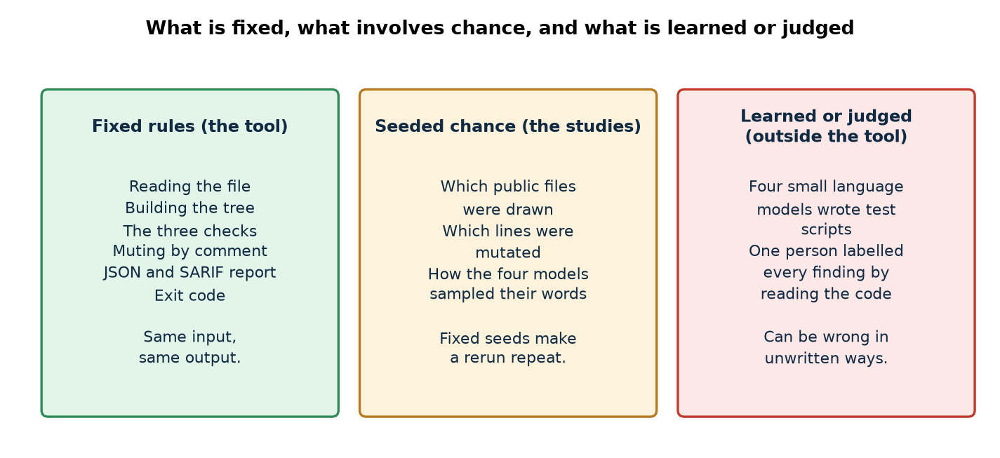
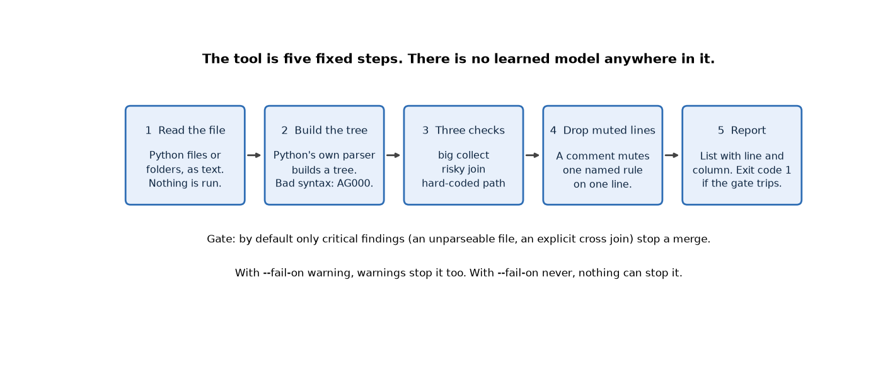
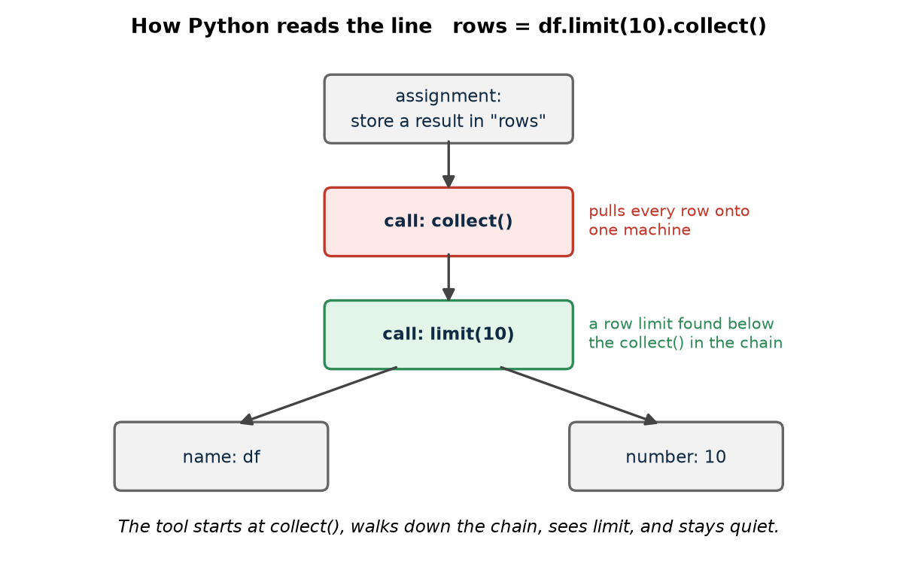
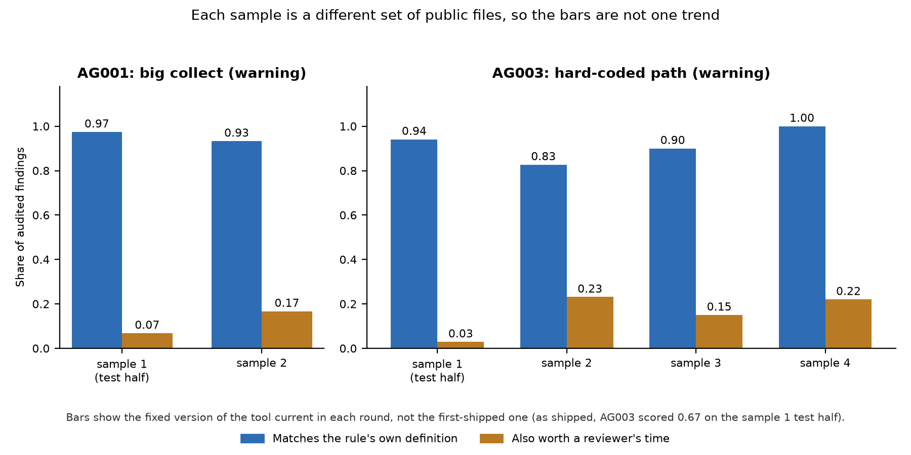

# datapipeline-ast-guard

*A small command-line tool that reads data-pipeline code written by AI assistants and warns about three costly mistakes before anyone runs it, plus a series of measurements of how often those warnings are right.*

Status: a working prototype at version 0.5, with measurements, last changed in October 2026. Code: https://github.com/PCSchmidt/datapipeline-ast-guard (under the MIT (Massachusetts Institute of Technology) licence, a permissive open-source licence). It is public on GitHub, the site that hosts code. It is not on the usual Python package index, and nothing shows that anyone but me has used it.

Suppose an AI assistant writes a job that joins two tables of two million rows each, and it forgets to say which columns should match. The job passes a test on ten sample rows. On the real cluster (a group of computers sharing the work) it tries to pair every row of one table with every row of the other, which is four trillion pairs, and the bill and the waiting time follow. That is one of three mistakes the tool looks for. The second is pulling a whole giant table onto a single machine, which crashes it. The third is hard-coding a file location such as `s3://prod-data/orders/2026/`, which ties the code to one environment. I call them the risky join, the big collect and the fixed path. The tool numbers them AG001 (big collect), AG002 (risky join) and AG003 (fixed path), and the rest of this guide uses the plain names. These are the usual traps in "data pipeline" code, meaning programs that move and reshape large tables of data in steps.

The tool reads Python files, never runs them, and prints each suspicious line. Each finding is either critical (serious enough to stop work) or a warning (worth a look, not a stop). By default only critical findings trip the gate, which is the check that decides whether a proposed change may go ahead. When the gate trips, the tool ends with an exit code of 1. An exit code is the number a program hands back when it finishes, and build systems read 1 as "failed". That is how the tool can block a merge, meaning the step that adds a proposed change to the main copy of the code. The idea behind it runs through my portfolio: a program that guesses (an AI writing code) should not be trusted until a fixed set of rules has checked its output.

The technique is called static analysis, which means examining code without running it, here through an AST (Abstract Syntax Tree). An AST is the structured outline Python itself builds when it reads a file, the way a grammar diagram breaks a sentence into subject, verb and object.

Here is what is fixed and what is not. A calculator is deterministic: the same input always gives the same answer. A weather forecast is probabilistic: it is a best guess that can be wrong. The tool is a calculator. It contains no learned model and no network access, and the same file gives the same findings every time, even after reformatting or renaming variables. Repeatable does not mean right, though; a rule can be repeatably wrong, and measuring how often is most of the project. Chance enters only in the studies, through random file samples with a fixed starting number (a "seed") so a rerun repeats, and through one person's judgement of each finding.

The headline result is modest. On code from public repositories the rules usually do what they say, but few of their warnings are worth a reviewer's time: about one in fifteen for the big-collect check on the first test, about one in six on a later sample. The risky-join check has never found a real mistake in any real file; it found one deliberate cross join (a join that pairs every row with every row). So I changed the default gate so that warnings no longer block a merge. AI coding agents wrote almost all of the code, and I directed the scope, plan, architecture and preferences.

If you have ten minutes, read the chapters on what it does, the results, and the strengths and shortcomings.

## What problem this solves

Teams now let AI assistants draft data-pipeline code, and reviewers have to catch the expensive mistakes by eye. A reviewer reading a two-hundred-line job does not always notice a missing join key, because the code looks reasonable and the test data is small. The people with this problem are data engineers who review such code, teams that let assistants open proposed changes against their pipelines, and anyone building an agent that writes data code. The README (the front-page description of a code project) names these readers. None is shown to exist beyond me.

The goal is a trustworthy first gate that is small enough to explain. Success has two parts: the rules should catch the patterns they name, and the warnings should be right often enough to be worth reading. The project measures both, and the second is where the results are weakest.

Other tools exist. A general Python checker for style or types does not know about data-pipeline hazards. A language model asked to review the code could read meaning, but it costs money on each call and answers differently from run to run. A skeptic could ask, "Why not just use one of those?" The fair answer is that this tool is narrower, cheaper and repeatable; the counterpoint is that it cannot tell a table from any other object, and a language model could.

The project deliberately does little. It has three checks. It does not check types, style, whether a join uses the right keys, SQL, or notebooks. The README lists items from the original plan that were not built, such as SQL (Structured Query Language) checks and a packaged add-on for GitHub's build system.

In short, the project is a narrow gate for three named mistakes, and its main contribution is the measurement of how often that gate is worth listening to.

## Where the project came from

The project began as an item in a longer roadmap and was trimmed to something small enough to measure. In short, it is a deliberately small slice of a larger plan. It targets PySpark (the Python interface to Apache Spark, a system that spreads big-data work across many computers) and pandas (a widely used Python library for tables of data), because they are the libraries the project's own plan names for this kind of code. It also tests Polars, another Python table library.

## What it does, step by step

You point the tool at Python files or a folder. For each file it asks Python to build the tree without importing or running anything, walks the tree looking for the three patterns, removes any finding muted by a comment on its line, and prints a list. The default output is JSON (JavaScript Object Notation, a plain-text format other programs can read). The alternative is SARIF (Static Analysis Results Interchange Format), a standard layout for checker results that GitHub can show as notes on the changed lines of a proposed change.

The project's own example file is the best illustration. It is a short, typical AI-written Spark job. The tool reports five findings: two fixed paths, one join with no keys, one cross join, and one big collect. A line that collects only the first hundred rows is correctly left alone. The cross join is the only critical finding, so the exit code is 1 and a merge would stop. The other four are warnings.

An AST is easiest to understand through one line. The line `rows = df.limit(10).collect()` becomes a small tree: an assignment at the top, a call to `collect()` under it, a call to `limit(10)` under that. To decide whether the `collect()` is dangerous, the tool starts at the call and walks down the chain of calls (one method after another on the same table), noting the names it passes. It sees `limit`, concludes the result is capped, and says nothing.

A fair everyday comparison is a building inspector reading blueprints. The inspector never builds the house, and can spot a staircase with no handrail from the drawing alone. The comparison breaks where the drawing stops: the inspector knows what a staircase is, while the tool does not know what a variable holds, so anything called `collect` looks like the dangerous call.

The tool is entirely automatic. A person reads the list and decides what to do. The only human control inside the tool is the muting comment: writing `# ast-guard: ignore[AG001]` at the end of a line silences that one named rule on that line, and only that rule.

In short, the tool reads files without running them, lists suspicious lines, and sets an exit code.

## The parts, the data and the rules

The tool has five parts, each with one job. A reader finds Python files. A parser asks Python for the tree and turns a file that cannot be read into a critical finding called AG000. A single walker visits the tree and applies the three checks. A filter drops muted findings. A reporter sorts the findings by line, prints them and sets the exit code. By default the exit code is 1 only when a critical finding exists. An option can make warnings stop a merge too, or let nothing stop one.

Four promises hold throughout. The code being checked is never imported or run; a search of the source found no call that executes text (a reading, not a test). A file that does not parse is a critical finding, never a quiet skip. A muting comment silences only the rule it names. And the output is sorted and fixed, so the same input gives the same list.

The data lives in the studies, not the tool. The project measured its rules on four samples of real code, each a set of Python files from public GitHub repositories about Spark, Polars, pandas and data engineering. The first has 300 files from 83 repositories, taken from the most-starred projects; the second has 288 files from 116 less famous ones; the third has 223 files from 91; and the fourth has 300 files from 133 newer repositories. Each later sample excluded every repository used before. The code itself is not saved, only a list of repository, version and file fingerprint (a short code that identifies a file's exact contents), plus my labels. These are convenience samples of public repositories, not random samples of pipelines, so the numbers describe those projects.

There are two other kinds of material: 200 scripts written by small language models (next chapters), and a hand-written challenge set of 133 short snippets, each marked in advance with the findings it should and should not produce, including cases marked "known hard" because the tool is expected to fail them.

In short, five small fixed parts do the work, and the data lives in the studies, not the tool.

## How the three checks work

The checks are written on top of Python's standard parser. Each has one toy example and one weakness.

**The big collect.** This flags a call such as `collect()` or `toPandas()` that copies a whole table, split across many computers, into one machine's memory. That works on ten rows and fails on a billion. To avoid flagging safe uses, the tool looks at the earlier names in the same chain. If it finds `limit`, `head`, `take` or a similar word, it treats the call as capped. `df.collect()` is flagged; `df.limit(100).toPandas()` is not. The weakness is that the tool does not know the type of what it sees, so any object with a `collect()` method is flagged. It also treats `sample` as a cap, although a one percent sample of a billion rows is still ten million rows.

**The risky join.** A join combines two tables by matching rows on a column, like matching customers to orders by customer number. With no column to match on, every row pairs with every row. An explicit cross join is reported as critical in any file that imports a table library. A join with no keys is reported only in PySpark files, and only as a warning, because pandas quietly joins on row labels and Polars refuses to run without keys. Toy example: two million customers and two million orders make four trillion pairs. The rule skips text joins such as `", ".join(names)`. The weakness is that `sep.join(parts)`, with a variable on both sides, looks exactly like a table join and is flagged. The rule also checks only that keys exist, not that they are the right ones.

**The fixed path.** This flags a string that looks like an absolute file location: something starting `/folder/name`, a drive letter such as `C:\`, or an address beginning with a storage scheme such as `s3://`, `gs://` or `hdfs://`. A fixed location ties the code to one machine. Most of the development effort went into exceptions, because many strings that start with a slash are not file locations: web addresses such as `/api/items`, stored-setting names, and patterns for matching text. Each exception has a test that also checks a neighbouring real path is still reported. The weakness is gaps: an upper-case `S3://` and any relative path such as `./data/x.csv` are missed.

A type-aware checker could tell a table from any other object and remove many false alarms, at the cost of a much larger tool. A language model could read meaning, at the cost of repeatability. Neither was tried.

In short, three small pattern checks decide on shape alone, and most of their effort goes into excluding look-alikes.

## The language models and what they were for

The tool contains no model. The only models in the project are four small free language models that wrote test scripts for the tool to be checked against. They are subjects of a test, not parts of the product.

Real code from public repositories rarely contains the patterns, so I wanted scripts written the way an assistant writes them. I wrote 50 everyday data-engineering tasks first: 20 for PySpark, 15 for Polars and 15 for pandas. A typical one is "Join the orders table with the customers table and find customers who have not placed an order in the last 90 days." The tasks do not mention any pattern the tool checks. Each of the four models got every task once, 200 scripts in all, on my own computer with fixed settings. The models were Qwen2.5-Coder 7B, Mistral 7B, Llama 3.2 3B and Gemma 4 12B. The protocol does not say why these four; my reading is that running locally cost nothing and kept everything on my machine. Hosted commercial models are probably closer to what teams use and were not tried, so these small models likely write simpler code than the assistants the tool is aimed at.

The models rarely wrote anything the tool targets. Of the 190 scripts that parsed, 17 contained any of the three patterns, and no model wrote a keyless or cross join. Eight scripts did not parse (two more replies held no code at all), and the tool caught every unparseable one as a critical finding. The labels saying which pattern each script truly contains were written before the tool was run on any of them. A first batch was thrown away unscored because most models wrote plain pandas whatever the task; the prompts were changed and the first batch is kept as superseded.

In short, four small free models supplied test material, they rarely wrote the risky patterns, and none of them is part of what the tool decides.

## Testing and trying to break it

The project has 28 tests, and all 28 pass in a fresh scratch copy, with none skipped. Most are unit tests, which check one small behaviour. One checks the exit code under each setting through the command line. One is a property test, which generates hundreds of random inputs and checks that a rule always holds: here, that arbitrary text of up to 300 characters never crashes the analyser. Many are regression tests, added when the evaluation found a false alarm, and each also checks that a neighbouring real case is still found. The tests touch 94 percent of the tool's statements. The 17 scripts that collect the samples and produce the results have no tests of their own.

Small bad inputs were also tried. An empty file, a syntax error and a stray null character are all handled: no findings for the first, one critical finding for the others. Three cases matter more.

- A file that is not saved in standard text encoding (UTF-8) crashes the tool with a Python error trace and exit code 1.
- An expression with 20,000 terms added together crashes it with a recursion error (Python giving up on very deep nesting).
- A muting comment on a later line of a multi-line chain does not mute, because a finding is reported where the call begins.

The crashes matter because a messy repository would hit them first. The exit code is still 1, so a build would stop, but with an error trace and not a finding, so the reader is not told which file or why. The tests do not cover either case.

The studies followed a fixed routine. Each study's plan, including a list of expectations written in advance so they could be wrong, was committed before its results. The labels for the 200 scripts were committed before the tool was run on them. The first study split each sample into a development half and a test half by repository; fixes were made after looking only at the development half, then both the original and the fixed version were run once on the test half. Later studies used a fresh sample each time, with nothing tuned on it. The plan for the third round was committed together with its code changes, not before, and the project says so. Only commit times are recorded, not push times, so an outsider cannot verify the order beyond the commit record.

CI (continuous integration, meaning automatic checks that run whenever code is pushed) runs the tests and a type check on Python 3.12. CI does not run a style check or any evaluation, so nothing automatic protects against a drop in the quality of the findings. Package versions are not fixed; in the scratch copy a fresh install picked up newer versions and all 28 tests still passed.

In short, the rules are well covered by small tests, and the weak side is unusual input, which can crash the tool instead of producing a finding.

## Does it work? The results

Two terms first. A finding is "right by the rule" when it is exactly what the rule's definition describes. It is "worth a reviewer's time" when a data engineer would also want to look at it. They are separate on purpose: a `collect()` in a tutorial that prints one row is right by the rule and not worth anyone's time. I use these two terms throughout. One person, who is also the tool's author, labelled every finding by reading it, and every sample is small, so all numbers are small-sample estimates. There was no rival tool to compare against.

**Noise.** On the first sample, the tool as first shipped flagged about 27 percent of real files, and the fixed version about 25 percent. On the second sample, under the earlier default where the big-collect check was critical, about 21 percent of files would have failed the gate. After the check was made a warning, no file in that sample failed for a real finding; the 2 percent that still failed had genuine syntax errors. The noise itself was not smaller. It no longer blocks.

**The big collect** is accurate by the rule: 97 percent of its findings on the first test half. But only 3 of 44 were worth a reviewer's time, about one in fifteen, because most were tutorial prints, one-row assertions and conversion helpers. On a later sample the share was about one in six.

**The fixed path** was the one that changed. As first shipped, it was right by the rule on only 0.67 of findings on the unseen test half of the first sample (0.58 when both halves are pooled), because it matched pieces of paths and web addresses. After the mechanical fixes it scored 0.94 on that same test half. The three later fresh samples scored 0.83, 0.90 and 1.00. Even so, the share worth a reviewer's time stayed at one in four or fewer. The plan for the last round predicted new kinds of false alarm would keep appearing, and on the fourth sample none did, though that sample was dominated by Spark configuration strings, so I would not call the list complete.

**The risky join** never found a real keyless join in any of the four samples. Its one true finding was a deliberate cross join that the function's own description announced.

The chart shows the fixed tool in each round. The only as-shipped figure it leaves out is the 0.67 above, which is why the first fixed-path bar (0.94) is higher than that number.

**Recall** is the share of real problems the tool finds. It could not be measured on real code, because not every file could be labelled. As a stand-in I injected known defects into real files, and the tool found essentially all of them in the plain forms. That is closer to a unit test than a measure of recall in the wild, because the sites came from the same syntax the tool reads. On the hand-written challenge set the original tool failed 17 of 133 cases, all of which I had marked "known hard" in advance, and the fixed version cured seven. On the model-written scripts, every labelled positive was found, though there were very few. Findings stayed identical under reformatting, renaming, extra comments and wrapping in a function, on all 300 files of the first sample and every parseable model-written script.

Taken together, the rules do what they say, deterministically and stably. What is not shown is that the warnings are worth their cost, that recall on real code is any good, or that anyone changes behaviour because of them. The real-code studies were not re-run for this guide, because the project saves only lists of files and not the code; the numbers above match the committed result files.

In short, the checks are mostly accurate but seldom worth a reviewer's time, which is why the default gate was changed so that only the clearest critical findings block a merge.

## Could it be put into real use?

It has never run outside my own machine and GitHub's build system. It is not published as a package, it is not hosted, and it has no known users. On a four-step ladder, from an experiment, to something that works locally, to something deployable, to something operated, it sits on the second. A few features resemble the third step, such as SARIF output and a container recipe (a file that describes a ready-to-run package), but nobody has deployed it.

Someone else can run it from the quickstart, and a fresh install worked in a scratch copy. A run only reads files and prints a list, so a re-run is harmless. It keeps no logs and needs no keys. Real use would need a packaged release, a reusable GitHub Action so a team can switch it on in a line, pinned versions, a quality check in CI, handling for unreadable files, and a short runbook (a page of operating instructions). The reusable pieces already here are the written protocol pattern, the challenge set and the mutation harness (the code that injects known defects), which someone could adapt to measure a different checker.

It contains no model and has no users, so it is a poor showcase for running AI in production. The most convincing small step would be to run it on a real team's proposed changes for a few weeks and record what reviewers did with the warnings.

In short, it works locally and has never been deployed or used by anyone else.

## Strengths, shortcomings, and the work still to do

The project's strongest feature is its method for checking its own results. The plans were written down first, with predictions that were allowed to fail, and several did. For example, the plan expected the fixed-path check to be the most accurate of the three as shipped, and it scored 0.58 pooled against 0.97 for the big-collect check. Each round used a fresh sample, and its fixes were designed from earlier data, so the new files were a real test. Negative results are reported as results, including that the join check found nothing.

The shortcomings fall into four groups.

The first is yield. Accurate warnings that few people want are still noise. Narrowing the big-collect check to clearly large tables needs types the tool does not have, which is a different project. I would leave both checks as warnings and document that.

The second is how little is known about recall and agreement. One rater, who also wrote the rules, labelled everything, and findings cluster in a few repositories, so the quoted ranges are optimistic. A second rater on a subsample would be a cheap way to show how much judgements agree. I would do that before adding rules.

The third is unusual input: the two crashes and the muting gap described above. Each has a cheap fix, and reporting a crash as a finding is the change I would do first.

The fourth is documentation that lags the code. The README's summary table lists 10 tests where there are 28, and one paragraph still says the benchmark is not built.

The cost to run is nothing: no service, key or special hardware, only Python 3.11 or newer and one small library. Security risk is low because it never executes what it reads; the main exposure is a crash on hostile input, which stops a build but runs nothing.

The three checks, the output formats, the exit codes and the muting comment are built and tested. Not built: SQL rules, further Spark checks, checks that generated code keeps its table layout, and a packaged GitHub Action. There are no empty stubs or skipped tests. A version 2 would need type information, which would be a redesign. The next milestone I would suggest is small: fix the crashes and the muting rule, correct the README, add the style check to CI, then get a second rater and a trial on a real team's code. The project is worth polishing and freezing, not growing into a general linter.

In short, the shortcomings are mostly cheap to fix, and the one that matters most is that the warnings are rarely worth acting on.

## How it was built, and who did what

AI coding agents wrote almost all of the code, the tests, the study scripts and the write-ups. The commit history credits Claude Sonnet 5.5 on 34 of 35 commits and Claude Opus 5.5 on the other. All commits are under my name. I directed the scope, the plan and the architecture.

What I decided is visible in the documents: that the tool should be narrow and deterministic, that each study's plan and expectations be written before the results, that the test half be scored once, that a fresh sample be used for each round, and that the big-collect check be lowered to a warning when the evidence did not support blocking on it. The commits fall on six separate days between 9 and 19 October 2026. The write-ups state that I labelled every finding by reading it; the commit record cannot show how long that took.

In short, this is an agent-written project that I directed, with scope, plans and publishing rules set by me.

## For recruiters and interviewers

**In thirty seconds.** I directed AI coding agents to build a small checker that catches three costly mistakes in AI-written data-pipeline code, and then measured on public code how often its warnings are right. They are usually accurate and rarely worth acting on, and I changed the default so they no longer block merges. **In two minutes**, add that every study was planned before its results, each round used fresh files, and the tool has no model, no deployment and no users.

What it shows is a measurement method: plans written first, fresh samples, predictions that could fail, and results that argued against the tool's own severity setting. It does not show that I can train a model, run a service for users, work in a team, scale to large data, or write the code by hand.

My current targets are AI engineer, forward-deployed AI engineer (an engineer who works close to a customer and fits AI tools to their problem), and applied AI or machine-learning engineer. This project fits best as evaluation and guardrails for AI-written output, and fits the model-building and operations sides of those roles poorly.

| What a role usually wants | What this project shows | How strong |
| --- | --- | --- |
| Evaluating the quality of AI output | Four fresh-sample studies, predictions that failed, reported plainly | Demonstrated |
| Guardrails and safety checks | A rule-based gate with exit codes and SARIF output | Partly |
| Clean, tested code with automatic checks | 28 passing tests, type check in CI; no quality gate | Partly |
| Deploying and operating an AI system | Never deployed, no users | Not shown |

Likely questions:

- *How do you know it works?* Each study had its plan written first and used files the tool had never seen; one person labelled everything, and nobody independent has repeated it.
- *If AI wrote the code, what did you do?* I set the problem, the narrow scope, the measurement rules and what to publish, and I made the severity change from the evidence.
- *What was the hardest problem?* Telling real hard-coded paths from look-alikes.
- *What would you change first?* Report unreadable files as findings instead of crashing, then get a second person to label a sample.
- *Why not use a language model to review?* It would cost money and vary between runs; this tool gives the same answer every time, at the price of not understanding meaning.
- *Isn't this just a trivial linter?* In a sense yes; its value is that it was measured, and I report that the warnings are seldom worth acting on.

A five-minute demo would run the tool on the example file and show the five findings and the exit code, show the tree picture and the muting comment, and open a protocol file next to its results file.

What not to exaggerate: the rules decide on names and shape and do not understand data, recall on real code is unmeasured, and there is no deployment and no users.

## Glossary

- **AST (Abstract Syntax Tree):** the structured outline Python builds from a file, like a grammar diagram of a sentence.
- **Static analysis:** checking code by reading it, without running it.
- **Critical and warning:** the two severities. Critical findings trip the gate by default; warnings do not.
- **Gate:** the check that decides whether a proposed change may go ahead.
- **Merge:** adding a proposed change to the main copy of the code.
- **Exit code:** the number a program returns when it finishes; 1 means failed.
- **Join:** combining two tables by matching rows on a column; with no column, every row pairs with every row.
- **Cluster:** a group of computers sharing the work.
- **Chain:** one method call after another on the same table.
- **Precision:** the share of the tool's findings that are right.
- **Recall:** the share of real problems the tool finds.
- **Right by the rule:** a finding that is exactly what the rule's definition describes.
- **Worth a reviewer's time:** a right finding that a data engineer would also want to look at.
- **SARIF (Static Analysis Results Interchange Format):** a standard file layout for checker results.
- **CI (continuous integration):** automatic checks that run whenever code is pushed.
- **Seed:** the starting number that makes a random process repeat.
- **Mutation test:** inserting a known defect into real code to see whether the tool finds it.

## Where to look in the code

The tool lives in `src/datapipeline_ast_guard`: the rules and the walker are in `rules.py` (about 370 lines), the command line is in `cli.py`, and the JSON and SARIF writers are in `report.py`. The tests are in `tests/test_rules.py`. The protocols and results of each study are in `docs`, the study scripts are in `scripts`, the saved file lists and labels are in `corpus`, and the saved numbers are in `results`. To run it: install with `pip install -e ".[dev]"`, run `agent-lint examples/agent_written_pipeline.py`, and run `pytest -q`. A new developer should read the example file, then `rules.py`, then the tests, then the first protocol and its results.
